# Golden set – review

130 records. Generated from `golden.jsonl`; fix records there, not here.

---

## golden-flow-0001

flowchart · medium · structured · ronnieallen

**Opis:**

> Na początku zbieram informacje o gościu. Następnie sprawdzam, czy rezerwacja jest dostępna. Jeśli tak, rejestruję gościa i proces się kończy. Jeśli nie, wyświetlam komunikat o niedostępności i proces się kończy.

**Diagram:**

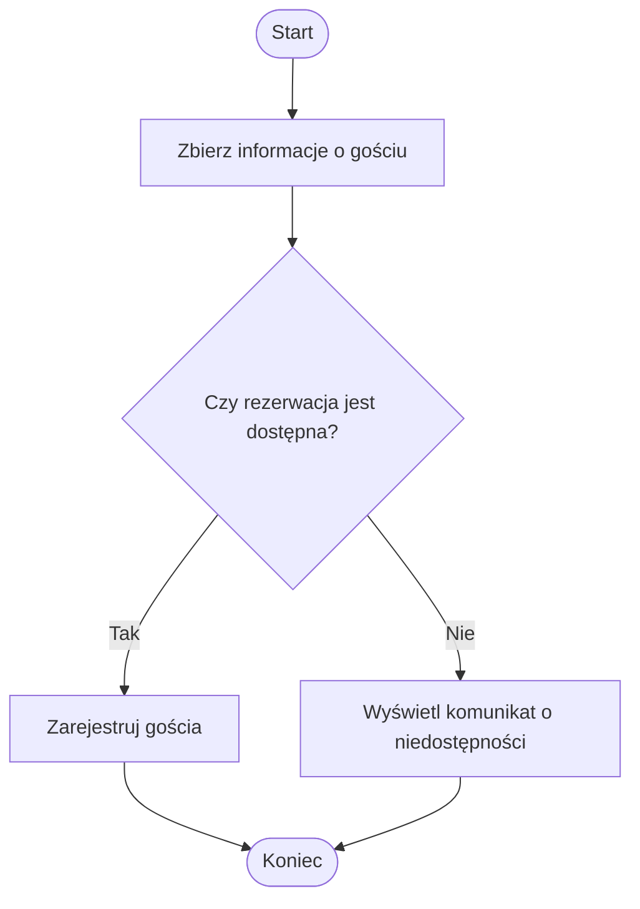

---

## golden-flow-0002

flowchart · medium · natural · ronnieallen

**Opis:**

> Ogólnie to działa tak: najpierw tworzę PR, a potem sprawdzam, czy jest gotowy do scalenia. Jeśli tak, to po prostu go scalam i to wszystko. Ale jeśli coś jest nie tak, to wracam do niego, przeglądam i aktualizuję, a potem znowu sprawdzam, czy jest już gotowy - i tak w kółko, dopóki nie będzie można go scalić.

**Diagram:**

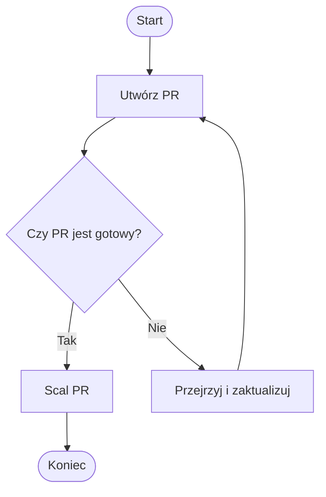

---

## golden-flow-0003

flowchart · medium · brief · ronnieallen

**Opis:**

> Zamówienie złożone, sprawdzam czy płatność przetworzona: jeśli tak, wysyłam zamówienie do magazynu i koniec; jeśli nie, płatność oczekująca i pytanie czy klient chce zapłacić teraz: jeśli tak, proszę o płatność, przetwarzam ją, potwierdzam wysyłkę i koniec; jeśli nie, proszę o płatność później, ustawiam przypomnienie i koniec.

**Diagram:**

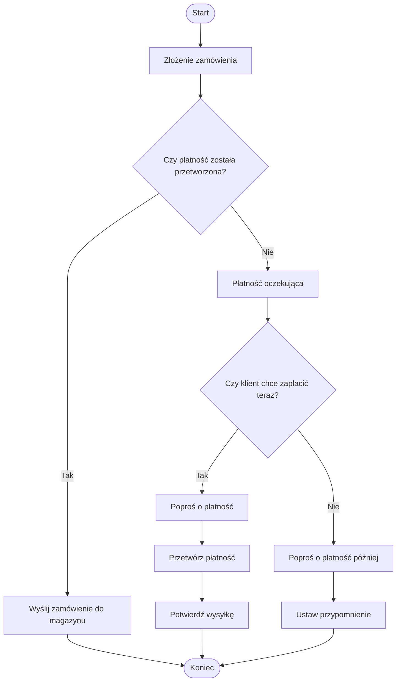

---

## golden-flow-0004

flowchart · medium · structured · ronnieallen

**Opis:**

> Proces zaczyna się od skanowania zapasów. Następnie sprawdzane jest, czy zapasy są wystarczające. Jeśli tak, zamówienie zostaje potwierdzone i proces się kończy. Jeśli nie, powiadamiany jest kierownik magazynu, a następnie proces wraca do kroku skanowania zapasów.

**Diagram:**

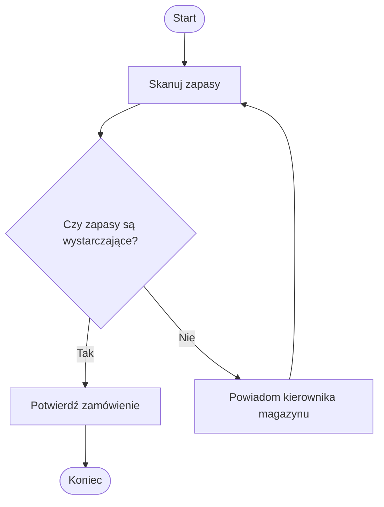

---

## golden-flow-0005

flowchart · medium · natural · ronnieallen

**Opis:**

> Cały proces zaczyna się od przesłania pliku. Potem skanuję ten plik w poszukiwaniu wirusa i sprawdzam, czy coś w nim siedzi. Jeśli nie ma wirusa, to po prostu oznaczam plik jako czysty - i na tym koniec. Ale jeśli plik zawiera wirusa, to mam inną ścieżkę: usuwam ten zainfekowany plik, a potem informuję o usunięciu pliku i dopiero wtedy kończę.

**Diagram:**

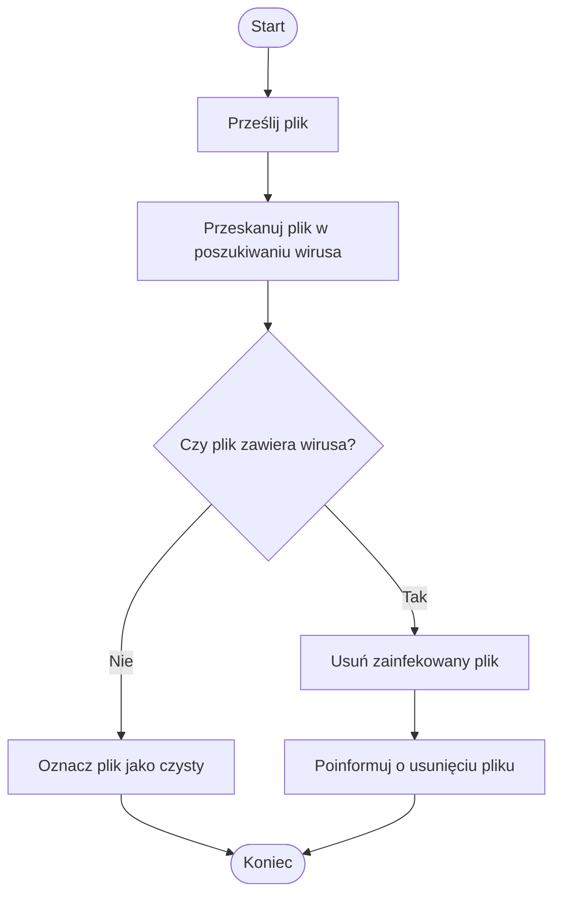

---

## golden-flow-0006

flowchart · medium · brief · ronnieallen

**Opis:**

> Logowanie przez Google, sprawdzenie czy zalogowano: tak - przejście do panelu i koniec; nie - zalogowanie się przez Google i powrót do logowania przez Google.

**Diagram:**

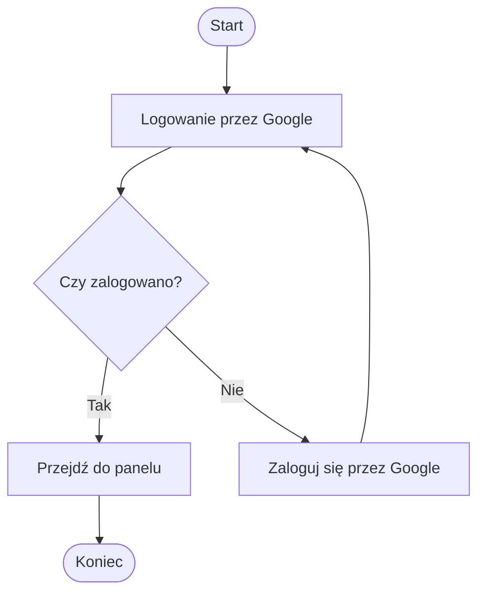

---

## golden-flow-0007

flowchart · medium · structured · ronnieallen

**Opis:**

> Proces zaczyna się od dodania produktu do koszyka. Następnie sprawdzam, czy wybrano metodę płatności. Jeśli tak, przechodzę do finalizacji zamówienia, a potem kończę proces finalizacji zamówienia, co kończy cały proces. Jeśli metoda płatności nie została wybrana, wracam na sam początek procesu, czyli do startu.

**Diagram:**

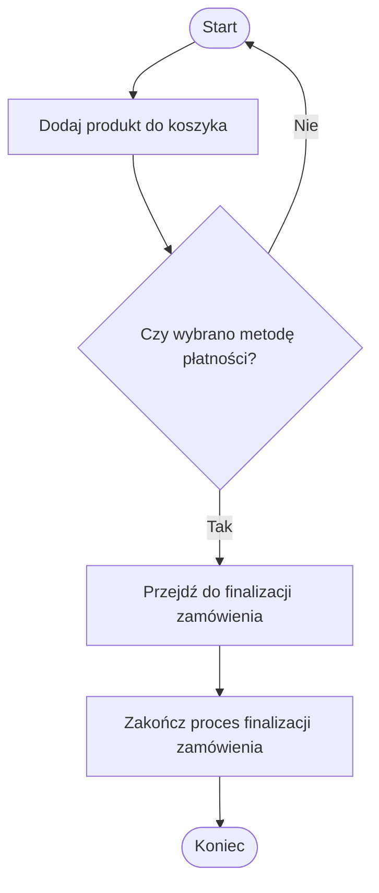

---

## golden-flow-0008

flowchart · medium · natural · ronnieallen

**Opis:**

> Chodzi mi o to, jak pilnujemy SLA. Na start patrzymy, które SLA zostały naruszone, i sprawdzamy, czy to naruszenie mieści się jeszcze w akceptowalnej tolerancji. Jak tak, to po prostu wysyłamy powiadomienie do interesariuszy i na tym kończymy. Gorzej jeśli przekroczenie jest większe niż powinno – wtedy rejestrujemy naruszenie, eskalujemy sprawę, a potem przeglądamy i dostosowujemy politykę SLA. Później wracamy do ponownej oceny tych naruszonych SLA i sprawdzamy je jeszcze raz od początku, czyli znowu identyfikujemy naruszone SLA i cała pętla się powtarza, aż w końcu naruszenie zmieści się w tolerancji i będzie można wysłać powiadomienie.

**Diagram:**

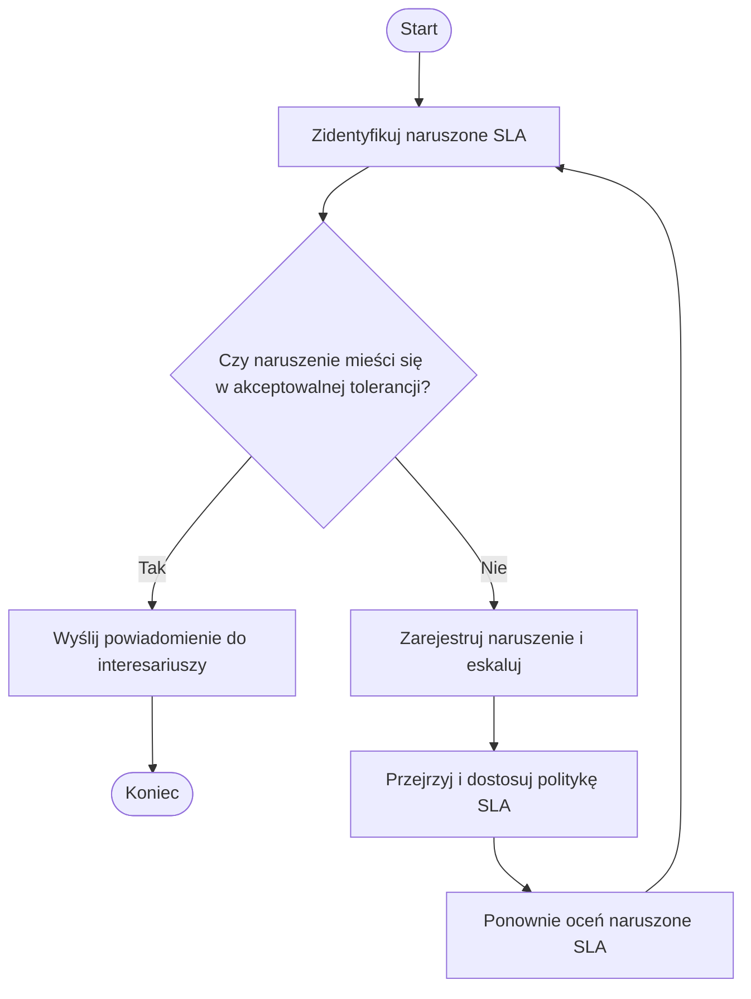

---

## golden-flow-0009

flowchart · medium · brief · ronnieallen

**Opis:**

> Pobieram wprowadzony kod kuponu i sprawdzam, czy jest prawidłowy: jeśli tak, kod zostaje uznany za ważny i proces się kończy; jeśli nie, kod jest nieprawidłowy, wyświetlam komunikat o błędzie i wracam do strony płatności, skąd ponownie pobieram kod kuponu.

**Diagram:**

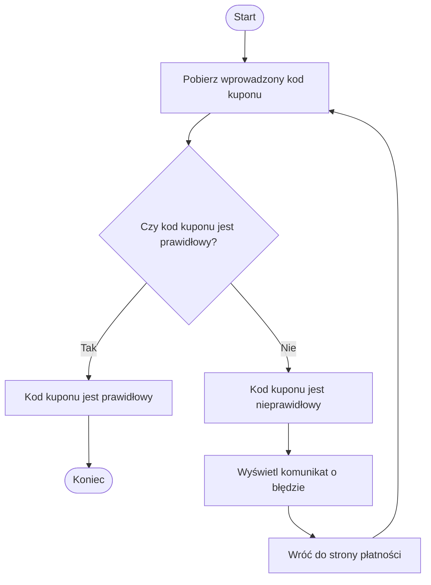

---

## golden-flow-0010

flowchart · hard · structured · ronnieallen

**Opis:**

> Proces zaczynam od wyodrębnienia treści e-maila. Następnie sprawdzam, czy temat jest podejrzany. Jeśli tak, oznaczam wiadomość jako potencjalny spam i na tym proces się kończy. Jeśli nie, kontynuuję analizę i sprawdzam reputację nadawcy. Potem sprawdzam, czy domena nadawcy znajduje się na czarnej liście. Jeśli tak, blokuję e-mail i proces się kończy. Jeśli nie, przekazuję wiadomość do weryfikacji. Następnie sprawdzam, czy treść wiadomości jest podejrzana. Jeśli tak, wyciszam nadawcę na tydzień i proces się kończy. Jeśli nie, przepuszczam e-mail i proces się kończy.

**Diagram:**

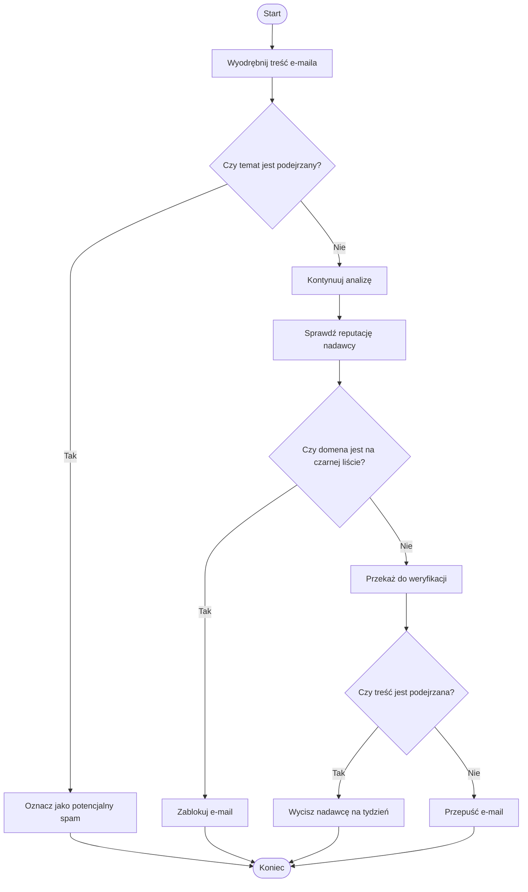

---

## golden-flow-0011

flowchart · medium · natural · ronnieallen

**Opis:**

> Chodzi o to, że najpierw sprawdzam zdolność kredytową klienta i patrzę, czy wynik jest co najmniej 600. Jeśli tak, to spokojnie przechodzimy dalej do kolejnych kroków procesu. A jak wynik jest niższy niż 600, to niestety trzeba odrzucić wniosek kredytowy i na tym sprawa się kończy.

**Diagram:**

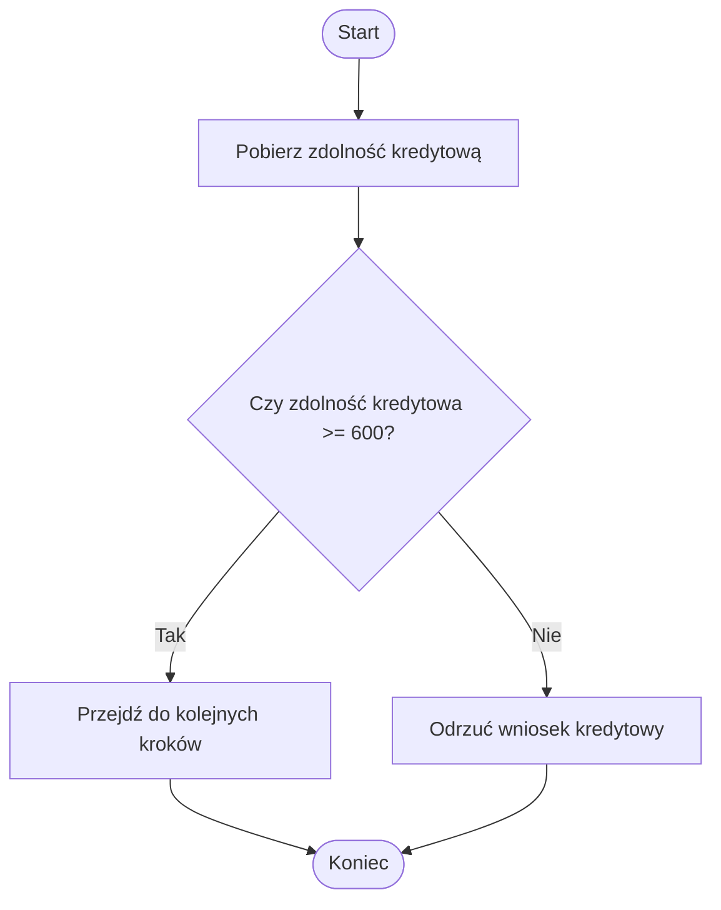

---

## golden-flow-0012

flowchart · medium · brief · ronnieallen

**Opis:**

> Sprawdzam saldo konta, potem pytanie czy saldo wystarcza: jeśli tak, wypłacam gotówkę i koniec; jeśli nie, brak wystarczających środków i koniec.

**Diagram:**

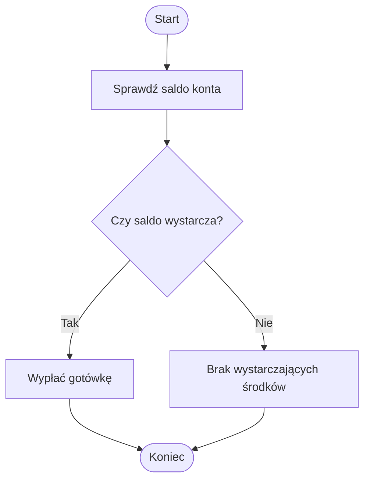

---

## golden-flow-0013

flowchart · medium · structured · ronnieallen

**Opis:**

> Na początku łączę się z bazą danych źródłową. Następnie sprawdzam, czy połączenie się powiodło. Jeśli tak, migruję dane ze źródła do celu i sprawdzam, czy migracja się powiodła. Jeśli migracja się powiodła, proces się kończy. Jeśli migracja się nie powiodła, wycofuję zmiany i ponawiam migrację, po czym wracam do kroku migracji danych ze źródła do celu. Jeśli natomiast połączenie z bazą danych nie powiodło się, sprawdzam konfigurację połączenia, a potem naprawiam problemy i ponawiam połączenie, po czym wracam do kroku łączenia się z bazą danych źródłową.

**Diagram:**

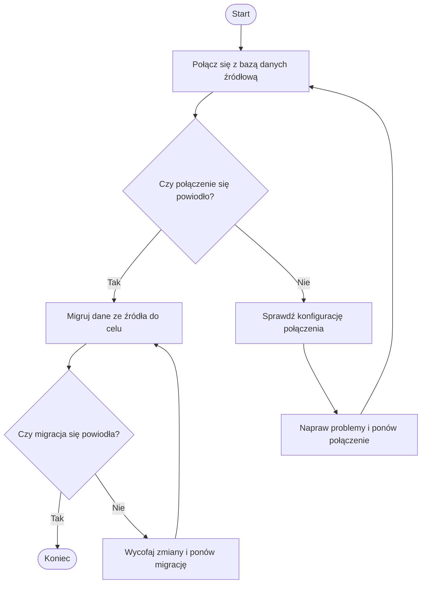

---

## golden-flow-0014

flowchart · medium · natural · ronnieallen

**Opis:**

> Mój proces zaczyna się od założenia konta, a potem sprawdzam, czy e-mail użytkownika jest już zweryfikowany. Jeśli tak, to sprawa jest prosta - po prostu aktywuję konto i na tym proces się kończy. Jeśli natomiast e-mail nie jest zweryfikowany, to wysyłam link weryfikacyjny, użytkownik weryfikuje swój e-mail i dopiero wtedy aktywuję konto, tak samo jak w pierwszym przypadku.

**Diagram:**

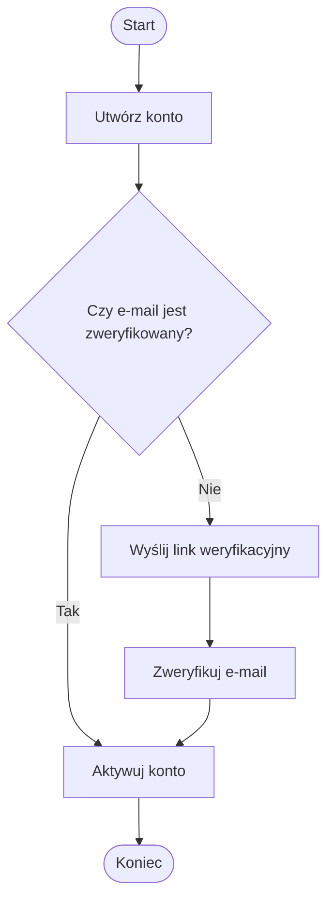

---

## golden-flow-0015

flowchart · medium · brief · ronnieallen

**Opis:**

> Zbieram dane pracownika i sprawdzam, czy ma roczne wynagrodzenie: jeśli tak, od razu liczę wynagrodzenie brutto; jeśli nie, najpierw zbieram stawkę godzinową i liczbę przepracowanych godzin, a potem liczę brutto. Dalej w obu przypadkach odejmuję potrącenia podatkowe, liczę netto i generuję odcinek wypłaty.

**Diagram:**

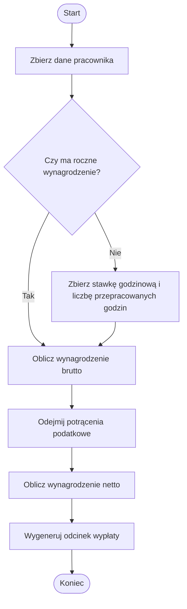

---

## golden-flow-0016

flowchart · medium · structured · ronnieallen

**Opis:**

> Proces zaczyna się od złożenia zamówienia. Następnie sprawdzam, czy płatność się powiodła. Jeśli płatność nie powiodła się, proces się kończy. Jeśli płatność się powiodła, potwierdzam adres dostawy. Potem przypisuję kierowcę. Kierowca odbiera zamówienie, następnie jedzie do celu, a potem wydaje jedzenie klientowi. Na koniec potwierdzam dostawę, co kończy proces.

**Diagram:**

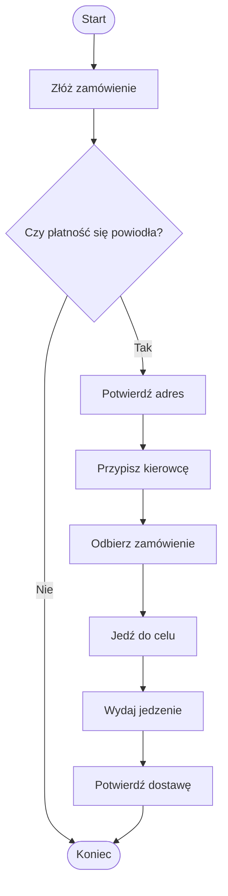

---

## golden-flow-0017

flowchart · medium · natural · ronnieallen

**Opis:**

> Na początku po prostu przyjmuję wniosek, który do mnie trafia. Potem patrzę, czy jest kompletny - to taki moment decydujący o wszystkim dalej. Jak jest w porządku, czyli kompletny, to składam wniosek o szkolenie i na tym temat się zamyka. Ale jeśli czegoś brakuje, to niestety odrzucam wniosek i sprawa też się kończy, tylko w drugą stronę.

**Diagram:**

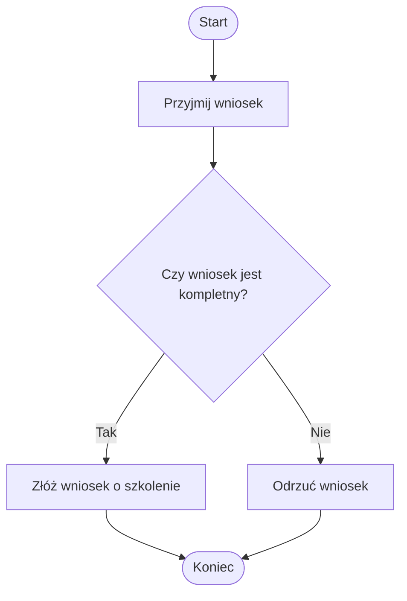

---

## golden-flow-0018

flowchart · medium · brief · ronnieallen

**Opis:**

> Tworzę plik Dockerfile, potem sprawdzam, czy obraz istnieje. Jeśli tak, kończę. Jeśli nie, buduję obraz, oznaczam go tagiem, publikuję w rejestrze i kończę jako gotowe.

**Diagram:**

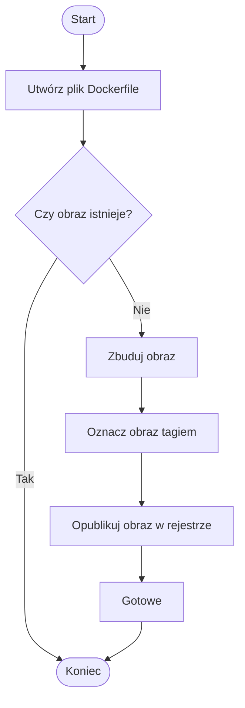

---

## golden-flow-0019

flowchart · medium · structured · ronnieallen

**Opis:**

> Proces zaczyna się od zidentyfikowania problemu. Następnie sprawdzam, czy to krytyczny problem. Jeśli tak, przypisuję eskalowane zgłoszenie. Jeśli nie, przekazuję sprawę do zespołu wsparcia. W obu przypadkach kolejnym krokiem jest skontaktowanie się z konsultantem, co kończy proces.

**Diagram:**

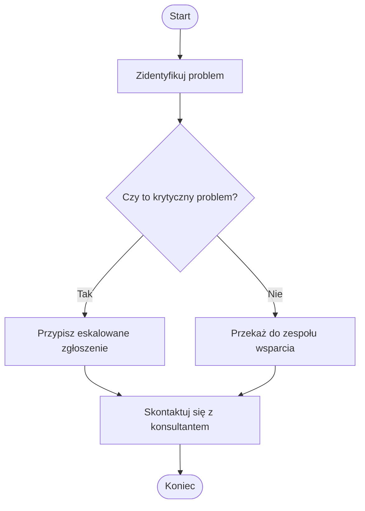

---

## golden-flow-0020

flowchart · medium · natural · ronnieallen

**Opis:**

> Cały proces zaczynam od skonfigurowania logowania. Potem sprawdzam, czy system w ogóle obsługuje rotację logów - i tu się rozjeżdża. Jeśli tak, to po prostu stosuję rotację logów. Gorzej, jeśli system nie wspiera rotacji - wtedy muszę ręcznie wykonać rotację logów. Obie ścieżki i tak schodzą się w tym samym miejscu: archiwizuję logi w magazynie i to by było na tyle.

**Diagram:**

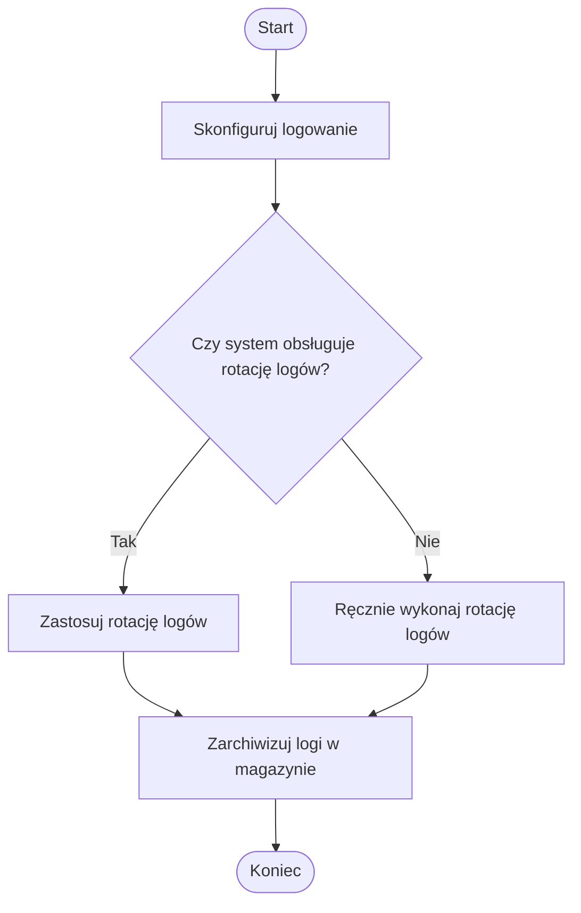

---

## golden-flow-0021

flowchart · medium · brief · ronnieallen

**Opis:**

> Sprawdzam aktualny poziom zapasów, jeśli jest poniżej progu uzupełniam towar, jeśli nie – kontynuuję normalną pracę.

**Diagram:**

```mermaid
flowchart TD
 A([Start]) --> B[Sprawdź aktualny poziom zapasów]
 B --> C{Czy zapasy są poniżej progu?}
 C -->|Tak| D[Uzupełnij towar]
 D --> Z([Koniec])
 C -->|Nie| E[Kontynuuj normalną pracę]
 E --> Z([Koniec])
```

---

## golden-flow-0022

flowchart · hard · structured · ronnieallen

**Opis:**

> Proces zaczyna się od identyfikacji konta użytkownika. Następnie sprawdzam, czy konto jest używane. Jeśli tak, konto jest usuwane natychmiast i proces się kończy. Jeśli nie, sprawdzam 30-dniowy okres karencji. Następnie weryfikuję, czy okres karencji jest aktywny. Jeśli tak, konto zostaje usunięte w ramach okresu karencji i proces się kończy. Jeśli nie, sprawdzam aktywność użytkownika. Kolejnym krokiem jest sprawdzenie, czy wykryto ostatnią aktywność. Jeśli tak, sprawa jest zgłaszana administratorowi i proces się kończy. Jeśli nie, potwierdzam żądanie usunięcia, a następnie finalizuję usuwanie konta, co kończy proces.

**Diagram:**

```mermaid
flowchart TD
A([Start]) --> B[Zidentyfikuj konto użytkownika]
B --> C{Czy konto jest używane?}
C -->|Tak| D[Usuń natychmiast]
D --> Z([Koniec])
C -->|Nie| E[Sprawdź 30-dniowy okres karencji]
E --> F{Czy okres karencji jest aktywny?}
F -->|Tak| G[Usuń konto w okresie karencji]
G --> Z([Koniec])
F -->|Nie| H[Sprawdź aktywność użytkownika]
H --> I{Czy wykryto ostatnią aktywność?}
I -->|Tak| J[Zgłoś administratorowi]
J --> Z([Koniec])
I -->|Nie| K[Potwierdź żądanie usunięcia]
K --> L[Zakończ usuwanie]
L --> Z([Koniec])
```

---

## golden-flow-0023

flowchart · medium · natural · ronnieallen

**Opis:**

> Chodzi mi o proces logowania. Najpierw sprawdzam dane logowania użytkownika i patrzę, czy są poprawne. Jeśli tak, to logowanie kończy się sukcesem i na tym koniec. Jeśli nie, to zwiększam licznik nieudanych prób i sprawdzam, czy nie przekroczył dopuszczalnego limitu. Gdy limit jest przekroczony, uruchamiam blokadę konta i wyświetlam użytkownikowi komunikat, że konto zostało zablokowane - i to już koniec procesu. Jeśli limit jeszcze nie został przekroczony, resetuję licznik blokad i wracam do sprawdzania danych logowania od nowa, więc user ma kolejną szansę na wpisanie poprawnych danych.

**Diagram:**

```mermaid
flowchart TD
 A([Start]) --> B[Sprawdź dane logowania]
 B --> C{Czy dane są poprawne?}
 C -->|Tak| D[Logowanie zakończone sukcesem]
 D --> Z([Koniec])
 C -->|Nie| E[Zwiększ liczbę prób]
 E --> F{Czy przekroczono liczbę prób?}
 F -->|Tak| G[Uruchom blokadę]
 G --> H[Wyświetl komunikat: Konto zablokowane]
 H --> Z([Koniec])
 F -->|Nie| I[Zresetuj licznik blokad]
 I --> B
```

---

## golden-flow-0024

flowchart · medium · brief · ronnieallen

**Opis:**

> Sprawdzam status lotu i oceniam, czy jest potwierdzony: jeśli tak, wydaję kartę pokładową i kończę; jeśli nie, zmieniam termin lub anuluję bilet, kontaktuję się z obsługą klienta, aktualizuję dane w systemie i kończę.

**Diagram:**

```mermaid
flowchart TD
 A([Start]) --> B[Sprawdź status lotu]
 B --> C{Czy lot jest potwierdzony?}
 C -->|Tak| D[Wydaj kartę pokładową]
 C -->|Nie| E[Zmień termin lub anuluj bilet]
 D --> Z([Koniec])
 E --> F[Skontaktuj się z obsługą klienta]
 F --> G[Zaktualizuj dane w systemie]
 G --> Z([Koniec])
```

---

## golden-flow-0025

flowchart · medium · structured · ronnieallen

**Opis:**

> Proces zaczyna się od wprowadzenia numeru karty kredytowej. Następnie sprawdzam, czy karta jest wydana przez bank. Jeśli tak, przeprowadzana jest walidacja bankowa, po której następuje przetwarzanie płatności i proces się kończy. Jeśli nie, wykonywane jest sprawdzenie pod kątem oszustwa, po którym wyświetlane jest ostrzeżenie o potencjalnym oszustwie, i proces się kończy.

**Diagram:**

```mermaid
flowchart TD
 A([Start]) --> B[Wprowadzenie numeru karty kredytowej]
 B --> C{Czy karta jest wydana przez bank?}
 C -->|Tak| D[Walidacja bankowa]
 C -->|Nie| E[Sprawdzenie pod kątem oszustwa]
 E --> F[Ostrzeżenie o potencjalnym oszustwie]
 F --> Z([Koniec])
 D --> G[Przetwarzanie płatności]
 G --> Z([Koniec])
```

---

## golden-flow-0026

flowchart · medium · natural · ronnieallen

**Opis:**

> Na początku sprawdzam, jaki plan subskrypcji mam aktualnie ustawiony. Potem zastanawiam się, czy chcę go zmienić, czyli zrobić upgrade albo downgrade. Jeśli tak, to po prostu zmieniam plan i na tym kończę. A jeśli dojdę do wniosku, że zmiana nie jest potrzebna, to zostaję przy obecnym planie i też kończę cały proces w tym miejscu.

**Diagram:**

```mermaid
flowchart TD
 A([Start]) --> B[Sprawdź aktualny plan subskrypcji]
 B --> C{Czy chcesz zmienić plan?}
 C -->|Tak| D[Zmień plan]
 D --> Z([Koniec])
 C -->|Nie| E[Pozostań przy obecnym planie]
 E --> Z([Koniec])
```

---

## golden-flow-0027

flowchart · medium · brief · ronnieallen

**Opis:**

> Ustawiam ścieżkę obrazu, sprawdzam czy plik istnieje: jeśli tak, zmieniam rozmiar obrazu; jeśli nie, tworzę plik i dopiero wtedy zmieniam rozmiar obrazu. Potem generuję miniaturę i koniec.

**Diagram:**

```mermaid
flowchart TD
 A([Start]) --> B[Ustaw ścieżkę obrazu]
 B --> C{Czy plik istnieje?}
 C -->|Tak| D[Zmień rozmiar obrazu]
 C -->|Nie| E[Utwórz plik]
 E --> D
 D --> F[Wygeneruj miniaturę]
 F --> Z([Koniec])
```

---

## golden-flow-0028

flowchart · medium · structured · ronnieallen

**Opis:**

> Proces zaczyna się od sprawdzenia ról użytkownika. Następnie sprawdzam, czy użytkownik należy do grupy administratorów. Jeśli tak, przyznaję dostęp i proces się kończy. Jeśli nie, sprawdzam uprawnienia użytkownika i weryfikuję, czy użytkownik ma wymagane uprawnienie. Jeśli ma wymagane uprawnienie, przechodzę do tego samego kroku przyznania dostępu. Jeśli nie ma wymaganego uprawnienia, odmawiam dostępu i proces się kończy.

**Diagram:**

```mermaid
flowchart TD
 A([Start]) --> B[Sprawdź role użytkownika]
 B --> C{Czy użytkownik jest w grupie administratorów?}
 C -->|Tak| D[Przyznaj dostęp]
 D --> Z([Koniec])
 C -->|Nie| E[Sprawdź uprawnienia użytkownika]
 E --> F{Czy użytkownik ma wymagane uprawnienie?}
 F -->|Tak| D
 F -->|Nie| G[Odmów dostępu]
 G --> Z([Koniec])
```

---

## golden-flow-0029

flowchart · medium · natural · ronnieallen

**Opis:**

> Chodzi o prosty mechanizm filtrowania wiadomości. Najpierw zbieram dane wejściowe, czyli po prostu biorę wiadomość do analizy. Potem sprawdzam, czy to spam - i w zależności od wyniku są dwie możliwości. Jeśli tak, to oznaczam wiadomość jako spam i na tym kończę. Jeśli nie, to oznaczam ją jako nie-spam i też kończę. Czyli generalnie jedna decyzja, dwie ścieżki, obie prowadzą do zakończenia procesu.

**Diagram:**

```mermaid
flowchart TD
A([Start]) --> B[Zbierz dane wejściowe]
B --> C{Czy to spam?}
C -->|Tak| D[Oznacz jako spam]
D --> Z([Koniec])
C -->|Nie| E[Oznacz jako nie-spam]
E --> Z([Koniec])
```

---

## golden-flow-0030

flowchart · medium · brief · ronnieallen

**Opis:**

> Klonuję repozytorium, sprawdzam, czy to gałąź produkcyjna: jeśli tak, wdrażam na produkcję, jeśli nie, wdrażam na środowisko deweloperskie, oba warianty kończą proces.

**Diagram:**

```mermaid
flowchart TD
 A([Start]) --> B[Sklonuj repozytorium]
 B --> C{Czy to gałąź produkcyjna?}
 C -->|Tak| D[Wdróż na produkcję]
 D --> Z([Koniec])
 C -->|Nie| E[Wdróż na środowisko deweloperskie]
 E --> Z([Koniec])
```

---

## golden-flow-0031

flowchart · medium · structured · ronnieallen

**Opis:**

> Proces zaczyna się od wysłania e-maila z linkiem do resetowania hasła. Następnie sprawdzam, czy użytkownik kliknął link. Jeśli tak, wyświetlany jest formularz resetowania hasła, użytkownik aktualizuje hasło, a system potwierdza aktualizację hasła, co kończy proces. Jeśli nie, oznacza to, że e-mail nie został kliknięty lub link jest nieważny, w takim przypadku użytkownik wraca do logowania, co również kończy proces.

**Diagram:**

```mermaid
flowchart TD
 A([Start]) --> B[Wyślij e-mail z linkiem do resetowania]
 B --> C{Czy użytkownik kliknął link?}
 C -->|Tak| D[Formularz resetowania hasła]
 D --> E[Zaktualizuj hasło]
 E --> F[Potwierdź aktualizację hasła]
 F --> Z([Koniec])
 C -->|Nie| G[E-mail niekliknięty lub nieważny]
 G --> H[Wróć do logowania]
 H --> Z([Koniec])
```

---

## golden-flow-0032

flowchart · medium · natural · ronnieallen

**Opis:**

> U nas to wygląda tak: pracownik najpierw składa wniosek urlopowy, no i wtedy sprawdzamy, czy urlop zostaje zatwierdzony. Jak jest zgoda, to po prostu przyznajemy urlop i sprawa załatwiona. Gorzej, jak wniosek zostaje odrzucony – wtedy trzeba zapytać kierownika, czy on potwierdza to odrzucenie. Jeśli potwierdza, to na tym kończymy, urlopu nie będzie. Ale jeśli kierownik się nie zgadza z odrzuceniem, to wniosek wraca do niego jeszcze raz do zatwierdzenia i cała procedura leci od nowa, czyli znowu wracamy do złożenia wniosku przez pracownika.

**Diagram:**

```mermaid
flowchart TD
A([Start]) --> B[Pracownik składa wniosek urlopowy]
B --> C{Czy urlop jest zatwierdzony?}
C -->|Tak| D[Urlop przyznany]
D --> Z([Koniec])
C -->|Nie| E[Odrzuca wniosek urlopowy]
E --> F{Czy kierownik potwierdza odrzucenie?}
F -->|Tak| Z([Koniec])
F -->|Nie| G[Składa ponownie wniosek do kierownika o zatwierdzenie]
G --> B
```

---

## golden-flow-0033

flowchart · medium · brief · ronnieallen

**Opis:**

> Zamówienie produktu, potem sprawdzenie czy płatność się powiodła: jeśli tak, potwierdzenie płatności, przekierowanie do strony pobierania i koniec; jeśli nie, wyświetlenie komunikatu o błędzie, przekierowanie ponownie do kasy i ponowne sprawdzenie, czy płatność się powiodła.

**Diagram:**

```mermaid
flowchart TD
 A([Start]) --> B[Zamów produkt]
 B --> C{Czy płatność się powiodła?}
 C -->|Tak| D[Potwierdź płatność]
 D --> E[Przekieruj do strony pobierania]
 E --> Z([Koniec])
 C -->|Nie| F[Wyświetl komunikat o błędzie]
 F --> G[Przekieruj ponownie do kasy]
 G --> C
```

---

## golden-flow-0034

flowchart · hard · structured · ronnieallen

**Opis:**

> Proces zaczyna się od odebrania zgłoszenia. Następnie sprawdzam, czy problem jest pilny. Jeśli tak, zgłoszenie jest przekazywane do pilnego wsparcia i proces się kończy. Jeśli nie, przechodzę do rozwiązania problemu. Potem sprawdzam, czy problem został rozwiązany. Jeśli nie, zgłoszenie jest przekazywane do dalszej analizy i proces się kończy. Jeśli tak, sprawdzam, czy klient jest zadowolony z rozwiązania. Jeśli klient jest zadowolony, zgłoszenie zostaje zamknięte i proces się kończy. Jeśli nie jest zadowolony, zgłoszenie jest przekierowywane do zespołu wsparcia, a następnie następuje kontakt z klientem w celu udzielenia dalszej pomocy, po czym proces się kończy.

**Diagram:**

```mermaid
flowchart TD
 A([Start]) --> B[Odbierz zgłoszenie]
 B --> C{Czy problem jest pilny?}
 C -->|Tak| D[Przekaż do pilnego wsparcia]
 D --> Z([Koniec])
 C -->|Nie| E[Rozwiąż problem]
 E --> F{Czy problem został rozwiązany?}
 F -->|Nie| G[Przekaż do dalszej analizy]
 G --> Z([Koniec])
 F -->|Tak| H{Czy klient jest zadowolony z rozwiązania?}
 H -->|Tak| I[Zamknij zgłoszenie]
 I --> Z([Koniec])
 H -->|Nie| J[Przekieruj do zespołu wsparcia]
 J --> K[Skontaktuj się z klientem w celu dalszej pomocy]
 K --> Z([Koniec])
```

---

## golden-flow-0035

flowchart · medium · natural · ronnieallen

**Opis:**

> Cały proces zaczynam od sprawdzenia kwoty zwrotu, jaką ktoś zgłasza. Potem patrzę, czy ta kwota mieści się w ustalonym limicie. Jak się mieści, to po prostu zatwierdzam zwrot i na tym kończę sprawę. A jeśli przekracza limit, to odrzucam zwrot i też kończę - nie ma tu żadnego dodatkowego kroku ani zawracania do wcześniejszego etapu.

**Diagram:**

```mermaid
flowchart TD
A([Start]) --> B[Sprawdź kwotę zwrotu]
B --> C{Czy zwrot mieści się w limicie?}
C -->|Tak| D[Zatwierdź zwrot]
D --> Z([Koniec])
C -->|Nie| E[Odrzuć zwrot]
E --> Z([Koniec])
```

---

## golden-flow-0036

flowchart · hard · brief · ronnieallen

**Opis:**

> Wczytuję plik CSV, potem sprawdzam jego poprawność: jeśli tak, waliduję wiersze i oznaczam niepoprawne jako błąd, co kończy proces; jeśli nie, proszę użytkownika o poprawienie CSV, ponawiam walidację i wracam do walidacji wierszy. Niezależnie sprawdzam, czy istnieje wiersz z błędem: jeśli tak, łączę wiersze z błędami z danymi oryginalnymi i zapisuję połączone dane, co kończy proces; jeśli nie, zapisuję oryginalne dane i zapisuję je jako CSV, co również kończy proces.

**Diagram:**

```mermaid
flowchart TD
 A([Start]) --> B[Wczytaj plik CSV]
 B --> C{Czy plik CSV jest poprawny?}
 C -->|Tak| D[Waliduj wiersze]
 D --> E[Oznacz niepoprawne wiersze jako błąd]
 E --> Z([Koniec])
 C -->|Nie| F[Poproś użytkownika o poprawienie pliku CSV]
 F --> G[Ponów walidację]
 G --> D
 B --> H{Czy istnieje wiersz z błędem?}
 H -->|Tak| I[Połącz wiersze z błędami z danymi oryginalnymi]
 I --> J[Zapisz połączone dane]
 J --> Z([Koniec])
 H -->|Nie| K[Zapisz oryginalne dane]
 K --> L[Zapisz jako CSV]
 L --> Z([Koniec])
```

---

## golden-flow-0037

flowchart · medium · structured · ronnieallen

**Opis:**

> Na początku wykonuję kopię zapasową bazy danych. Następnie sprawdzam, czy kopia zapasowa się powiodła. Jeśli tak, przechodzę do weryfikacji kopii zapasowej, a po jej zakończeniu proces się kończy. Jeśli nie, ponawiam kopię zapasową i weryfikację, a następnie wracam do kroku weryfikacji kopii zapasowej.

**Diagram:**

```mermaid
flowchart TD
A([Start]) --> B[Wykonaj kopię zapasową bazy danych]
B --> C{Czy kopia zapasowa się powiodła?}
C -->|Tak| D[Zweryfikuj kopię zapasową]
D --> Z([Koniec])
C -->|Nie| E[Ponów kopię zapasową i weryfikację]
E --> D
```

---

## golden-flow-0038

flowchart · medium · natural · ronnieallen

**Opis:**

> Chodzi mi o to, żeby pokazać, jak u nas wygląda cały proces przetwarzania danych. Zaczynamy od zebrania danych, a potem sprawdzamy, czy są czyste. Jeśli tak, to od razu zapisujemy je tymczasowo, a jak nie, to najpierw trzeba je wyczyścić i dopiero wtedy lądują w tym tymczasowym zapisie. Potem przekształcamy dane i ładujemy je do hurtowni. Na końcu sprawdzamy, czy wystąpił błąd – jeśli nie, to proces się kończy, a jeśli tak, to zapisujemy szczegóły błędu i wracamy do ładowania danych do hurtowni, żeby spróbować jeszcze raz. Tak to się kręci, dopóki ładowanie się nie powiedzie.

**Diagram:**

```mermaid
flowchart TD
 A([Start]) --> B[Zbierz dane]
 B --> C{Czy dane są czyste?}
 C -->|Tak| D[Zapisz dane tymczasowo]
 C -->|Nie| E[Wyczyść dane]
 E --> D
 D --> F[Przekształć dane]
 F --> G[Załaduj dane do hurtowni]
 G --> H{Czy wystąpił błąd?}
 H -->|Nie| Z([Koniec])
 H -->|Tak| I[Zapisz szczegóły błędu]
 I --> G
```

---

## golden-flow-0039

flowchart · medium · brief · ronnieallen

**Opis:**

> Otrzymuję zgłoszenie błędu, sprawdzam czy ma przypisanego programistę: jeśli tak, kończę, jeśli nie, przypisuję je do programisty X i kończę.

**Diagram:**

```mermaid
flowchart TD
 A([Start]) --> B[Otrzymaj zgłoszenie błędu]
 B --> C{Czy ma przypisanego programistę?}
 C -->|Tak| Z([Koniec])
 C -->|Nie| D[Przypisz do programisty X]
 D --> Z([Koniec])
```

---

## golden-flow-0040

flowchart · medium · structured · ronnieallen

**Opis:**

> Proces zaczyna się od złożenia wniosku. Następnie wniosek jest przeglądany. Potem sprawdzane jest, czy wniosek jest zasadny. Jeśli tak, wniosek jest zatwierdzany, co kończy proces. Jeśli nie, wniosek jest odrzucany, co również kończy proces.

**Diagram:**

```mermaid
flowchart TD
 A([Start]) --> B[Złóż wniosek]
 B --> C[Przejrzyj wniosek]
 C --> D{Czy wniosek jest zasadny?}
 D -->|Tak| E[Zatwierdź wniosek]
 E --> Z([Koniec])
 D -->|Nie| F[Odrzuć wniosek]
 F --> Z([Koniec])
```

---

## golden-flow-0041

flowchart · medium · natural · ronnieallen

**Opis:**

> Chodzi o to, że najpierw trzeba przygotować środowisko, a potem sprawdzamy, czy test przeszedł. Jak wszystko jest OK, to po prostu publikujemy wyniki jako PASS i na tym koniec. Gorzej, jeśli test nie przejdzie - wtedy zapisuję błędy, które wystąpiły, i uruchamiam ponownie te testy, które nie zaliczyły. Na końcu i tak proces się kończy, tylko że ze statusem "zakończony z błędami", zamiast sukcesu.

**Diagram:**

```mermaid
flowchart TD
A([Start]) --> B[Przygotuj środowisko]
B --> C{Czy test przeszedł?}
C -->|Tak| D[Opublikuj wyniki jako PASS]
D --> Z([Koniec])
C -->|Nie| E[Zaloguj błędy testu]
E --> F[Uruchom ponownie nieudane testy]
F --> G[Test zakończony z błędami]
G --> Z([Koniec])
```

---

## golden-flow-0042

flowchart · medium · brief · ronnieallen

**Opis:**

> Proszę o dostęp do profilu Google użytkownika; jeśli dostęp przyznany, uwierzytelniam użytkownika i koniec, jeśli nie, odmawiam dostępu i koniec.

**Diagram:**

```mermaid
flowchart TD
A([Start]) --> B[Poproś o dostęp do profilu Google użytkownika]
B --> C{Czy dostęp został przyznany?}
C -->|Tak| D[Uwierzytelnij użytkownika]
D --> Z([Koniec])
C -->|Nie| E[Odmów dostępu]
E --> Z([Koniec])
```

---

## golden-flow-0043

flowchart · medium · structured · ronnieallen

**Opis:**

> Proces zaczynam od zidentyfikowania dotkniętych usług. Następnie sprawdzam, czy doszło do naruszenia SLA. Jeśli tak, wywołuję alert i proces się kończy. Jeśli nie, kontynuuję monitorowanie, a potem przeglądam wcześniejsze incydenty. Na tej podstawie dostosowuję SLA lub zasady, po czym wracam do sprawdzenia, czy doszło do naruszenia SLA.

**Diagram:**

```mermaid
flowchart TD
 A([Start]) --> B[Zidentyfikuj dotknięte usługi]
 B --> C{Czy doszło do naruszenia SLA?}
 C -->|Tak| D[Wywołaj alert]
 D --> Z([Koniec])
 C -->|Nie| E[Kontynuuj monitorowanie]
 E --> F[Przejrzyj wcześniejsze incydenty]
 F --> G[Dostosuj SLA lub zasady]
 G --> C
```

---

## golden-flow-0044

flowchart · medium · natural · ronnieallen

**Opis:**

> Chodzi mi o taki prosty proces zakupowy. Klient dodaje produkt do koszyka i wtedy sprawdzam, czy chce od razu przejść do realizacji zakupu. Jeśli tak, to po prostu przechodzimy do finalizacji i to by było na tyle. Ale jeśli jeszcze nie jest gotowy, to zostaje w koszyku, kontynuuje zakupy, wraca na stronę koszyka i stamtąd znowu trafia do tego samego miejsca, czyli do realizacji zakupu. Czyli niezależnie od tego, czy od razu kupuje, czy najpierw dokłada coś do koszyka, ostatecznie i tak kończy się na przejściu do realizacji zakupu.

**Diagram:**

```mermaid
flowchart TD
 A([Start]) --> B[Produkt dodany do koszyka]
 B --> C{Czy zażądano realizacji zakupu?}
 C -->|Tak| D[Przejdź do realizacji zakupu]
 D --> Z([Koniec])
 C -->|Nie| E[Pozostań w koszyku]
 E --> F[Kontynuuj zakupy]
 F --> G[Wróć do strony koszyka]
 G --> D
```

---

## golden-flow-0045

flowchart · medium · brief · ronnieallen

**Opis:**

> Tworzę pull request, potem sprawdzam, czy wszystkie wymagane zmiany zostały zrecenzowane: jeśli nie, wracam do tworzenia pull requestu, jeśli tak, zatwierdzam zmiany. Następnie sprawdzam, czy projekt jest gotowy do scalenia: jeśli tak, kończę, jeśli nie, wracam do tworzenia pull requestu.

**Diagram:**

```mermaid
flowchart TD
A([Start])
B[Utwórz pull request]
C{Czy wszystkie wymagane zmiany zostały sprawdzone?}
D[Zatwierdź zmiany]
E{Czy projekt jest gotowy do scalenia?}
Z([Koniec])

 A --> B
 B --> C
 C -->|Tak| D
 C -->|Nie| B

 D --> E
 E -->|Tak| Z
 E -->|Nie| B
```

---

## golden-flow-0046

flowchart · medium · structured · ronnieallen

**Opis:**

> Proces zaczyna się od złożenia wniosku o kredyt. Następnie sprawdzam, czy wynik zdolności kredytowej jest dostępny. Jeśli tak, przekazuję wniosek do oceny i proces się kończy. Jeśli nie, wykonuję sprawdzenie zdolności kredytowej, a potem również przekazuję wniosek do oceny.

**Diagram:**

```mermaid
flowchart TD
 A([Start]) --> B[Złóż wniosek o kredyt]
 B --> C{Czy wynik zdolności kredytowej jest dostępny?}
 C -->|Tak| D[Przekaż wniosek do oceny]
 D --> Z([Koniec])
 C -->|Nie| E[Wykonaj sprawdzenie zdolności kredytowej]
 E --> D
```

---

## golden-flow-0047

flowchart · medium · natural · ronnieallen

**Opis:**

> Proces zaczynam od zebrania danych od użytkownika, a potem po prostu sprawdzam, czy wpisał jakiś kod kuponu. Jeśli tak, to taki kod trzeba zwalidować i to kończy cały proces. A jeśli nie wpisał żadnego kodu, to po prostu kontynuuję dalej bez kuponu i to też od razu kończy proces.

**Diagram:**

```mermaid
flowchart TD
 A([Start]) --> B[Zbierz dane od użytkownika]
 B --> C{Czy wpisano kod kuponu?}
 C -->|Tak| D[Zwaliduj kod kuponu]
 D --> Z([Koniec])
 C -->|Nie| E[Kontynuuj bez kuponu]
 E --> Z([Koniec])
```

---

## golden-flow-0048

flowchart · medium · brief · ronnieallen

**Opis:**

> Odbieram zgłoszenie i sprawdzam, czy kandydat kwalifikuje się na poziom podstawowy: jeśli tak, przechodzi weryfikację wstępną, przygotowuję list ofertowy i wysyłam go kandydatowi; jeśli nie, odrzucam zgłoszenie.

**Diagram:**

```mermaid
flowchart TD
 A([Start]) --> B[Odbierz zgłoszenie]
 B --> C{Czy kandydat kwalifikuje się na poziom podstawowy?}
 C -->|Tak| D[Przejdź weryfikację wstępną]
 D --> E[Przygotuj list ofertowy]
 E --> F[Wyślij list ofertowy do kandydata]
 F --> Z([Koniec])
 C -->|Nie| G[Odrzuć zgłoszenie]
 G --> Z([Koniec])
```

---

## golden-flow-0049

flowchart · medium · structured · ronnieallen

**Opis:**

> Na początku wybieram plik. Następnie sprawdzam, czy jest to dokument. Jeśli tak, przesyłam go do magazynu. Jeśli nie jest to dokument, przesyłam go bezpośrednio. W obu przypadkach kolejnym krokiem jest skanowanie antywirusowe, po którym proces się kończy.

**Diagram:**

```mermaid
flowchart TD
 A([Start]) --> B[Wybierz plik]
 B --> C{Czy to dokument?}
 C -->|Tak| D[Prześlij do magazynu]
 C -->|Nie| E[Prześlij bezpośrednio]
 D --> F[Skanowanie antywirusowe]
 E --> F
 F --> Z([Koniec])
```

---

## golden-flow-0050

flowchart · medium · natural · ronnieallen

**Opis:**

> Zaczynam od tego, że identyfikuję zgłoszony problem, czyli po prostu ustalam, z czym mam do czynienia. Potem patrzę, czy sprawa jest poważna - jeśli waga problemu jest wysoka, od razu przekazuję to dalej do zespołu wsparcia, żeby się tym zajęli. Jeśli jednak nie jest to nic poważnego, to sam załatwiam sprawę na czacie z użytkownikiem. W obu przypadkach, czy to po przekazaniu do wsparcia, czy po rozwiązaniu na czacie, proces się kończy.

**Diagram:**

```mermaid
flowchart TD
 A([Start]) --> B[Zidentyfikuj problem]
 B --> C{Czy waga problemu jest wysoka?}
 C -->|Tak| D[Przypisz do zespołu wsparcia]
 C -->|Nie| E[Rozwiąż problem przez czat]
 E --> Z([Koniec])
 D --> Z([Koniec])
```

---

## golden-flow-0051

flowchart · medium · brief · ronnieallen

**Opis:**

> Sprawdzam stany magazynowe. Jeśli wystarczające - potwierdzam zamówienie i kończę. Jeśli nie - sprawdzam, czy są braki: gdy tak, kontaktuję się z dostawcą o uzupełnienie i wracam do sprawdzania stanów; gdy nie, odrzucam zamówienie z powodu braku zapasów i kończę.

**Diagram:**

```mermaid
flowchart TD
 A([Start]) --> B[Sprawdź stany magazynowe]
 B --> C{Czy stany magazynowe są wystarczające?}
 C -->|Tak| D[Przejdź do potwierdzenia zamówienia]
 D --> Z([Koniec])
 C -->|Nie| E{Czy występują braki?}
 E -->|Tak| F[Skontaktuj się z dostawcą w celu uzupełnienia zapasów]
 F --> B
 E -->|Nie| H[Odrzuć zamówienie z powodu braku zapasów]
 H --> Z([Koniec])
```

---

## golden-flow-0052

flowchart · medium · structured · ronnieallen

**Opis:**

> Na początku identyfikuję logi, które mają zostać poddane rotacji. Następnie sprawdzam, czy muszę je zarchiwizować. Jeśli tak, archiwizuję logi, a potem wykonuję ich rotację. Jeśli nie, od razu wykonuję rotację logów. Po rotacji logów proces się kończy.

**Diagram:**

```mermaid
flowchart TD
 A([Start]) --> B[Zidentyfikuj logi do rotacji]
 B --> C{Czy musisz zarchiwizować logi?}
 C -->|Tak| D[Zarchiwizuj logi]
 D --> E[Wykonaj rotację logów]
 C -->|Nie| E
 E --> Z([Koniec])
```

---

## golden-flow-0053

flowchart · medium · natural · ronnieallen

**Opis:**

> Zaczynam od sprawdzenia aktualnego stanu, a potem patrzę, czy to środowisko produkcyjne. Jeśli tak, to od razu zatrzymuję migrację i na tym kończę - nie ma sensu ryzykować na produkcji. Jeśli nie, czyli mam zielone światło, kontynuuję migrację: najpierw hurtowo importuję dane początkowe, potem stosuję skrypty migracji i testuję zmigrowaną bazę danych. Jeśli test się powiedzie, migrację uznaję za zakończoną i to już koniec procesu. Jeśli jednak test się nie powiedzie, wycofuję zmiany i wracam do importu danych początkowych, żeby spróbować jeszcze raz całą sekwencję od nowa.

**Diagram:**

```mermaid
flowchart TD
 A([Start]) --> B[Sprawdź aktualny stan]
 B --> C{Czy to środowisko produkcyjne?}
 C -->|Tak| D[Zatrzymaj migrację]
 D --> Z([Koniec])
 C -->|Nie| E[Kontynuuj migrację]
 E --> F[Zaimportuj hurtowo dane początkowe]
 F --> G[Zastosuj skrypty migracji]
 G --> H[Przetestuj zmigrowaną bazę danych]
 H --> I{Czy test się powiódł?}
 I -->|Tak| J[Zakończ migrację]
 J --> Z([Koniec])
 I -->|Nie| K[Wycofaj zmiany]
 K --> F
```

---

## golden-flow-0054

flowchart · medium · brief · ronnieallen

**Opis:**

> Autoryzuję płatność, potem sprawdzam, czy kontrola oszustw jest włączona: jeśli tak, wykonuję sprawdzenie pod kątem oszustw i kończę, jeśli nie, płatność uznaję za opłaconą bez kontroli oszustw i kończę.

**Diagram:**

```mermaid
flowchart TD
A([Start]) --> B[Autoryzuj płatność]
B --> C{Czy kontrola oszustw jest włączona?}
C -->|Tak| D[Sprawdź pod kątem oszustw]
D --> Z([Koniec])
C -->|Nie| E[Opłacono bez kontroli oszustw]
E --> Z([Koniec])
```

---

## golden-flow-0055

flowchart · hard · structured · ronnieallen

**Opis:**

> Proces zaczynam od sklonowania repozytorium. Następnie sprawdzam, czy repozytorium jest prywatne. Jeśli tak, tworzę klucz SSH, a jeśli nie, wprowadzam dane uwierzytelniające. W obu przypadkach kolejnym krokiem jest dodanie klucza SSH do GitHub. Potem scalam zmiany do głównej gałęzi i wypycham zmiany do zdalnego repozytorium. Następnie sprawdzam, czy dodano notatkę wydania. Jeśli tak, tworzę pull request, a jeśli nie, pomijam tworzenie pull requesta. W obu przypadkach kolejnym krokiem jest scalenie pull requesta. Później sprawdzam, czy istniał skrypt wdrożeniowy. Jeśli tak, uruchamiam skrypt wdrożeniowy, a jeśli nie, wdrażam za pomocą Docker. Na koniec, niezależnie od wybranej ścieżki, monitoruję wdrożenie.

**Diagram:**

```mermaid
flowchart TD
 A([Start]) --> B[Sklonuj repozytorium]
 B --> C{Czy repozytorium jest prywatne?}
 C -->|Tak| D[Utwórz klucz SSH]
 C -->|Nie| E[Wprowadź dane uwierzytelniające]
 D --> F[Dodaj klucz SSH do GitHub]
 E --> F
 F --> G[Scal do głównej gałęzi]
 G --> H[Wypchnij zmiany do zdalnego repozytorium]
 H --> I{Czy dodano notatkę wydania?}
 I -->|Tak| J[Utwórz pull request]
 I -->|Nie| K[Pomiń tworzenie pull requesta]
 J --> L[Scal pull request]
 K --> L
 L --> M{Czy istniał skrypt wdrożeniowy?}
 M -->|Tak| N[Uruchom skrypt wdrożeniowy]
 M -->|Nie| O[Wdróż za pomocą Docker]
 N --> P[Monitoruj wdrożenie]
 O --> P
 P --> Z([Koniec])
```

---

## golden-flow-0056

flowchart · medium · natural · ronnieallen

**Opis:**

> Cały proces zaczyna się od tego, że wpada nowy e-mail. System od razu sprawdza, czy to spam czy nie. Jeśli nie jest to spam, sprawa jest prosta – wiadomość zostaje oznaczona jako normalna i na tym koniec. Gorzej, jeśli to jednak spam – wtedy taki mail trzeba oznaczyć do przeglądu, nadać mu priorytet, żeby ktoś ręcznie go sklasyfikował, potem wysłać automatyczną odpowiedź i na koniec powiadomić użytkownika o całej sytuacji. Dopiero wtedy proces się kończy.

**Diagram:**

```mermaid
flowchart TD
A([Start]) --> B[Odbierz e-mail]
B --> C{Czy to spam?}
C -->|Nie| D[Oznacz jako normalny]
D --> Z([Koniec])
C -->|Tak| E[Oznacz do przeglądu]
E --> F[Nadaj priorytet do ręcznej klasyfikacji]
F --> G[Wyślij automatyczną odpowiedź]
G --> H[Powiadom użytkownika]
H --> Z([Koniec])
```

---

## golden-flow-0057

flowchart · medium · brief · ronnieallen

**Opis:**

> Zapisuję szczegóły wniosku, sprawdzam czy wymagana jest akceptacja: jeśli nie, koniec; jeśli tak, wysyłam prośbę do kierownika i sprawdzam jego decyzję - przy akceptacji zatwierdzam wniosek urlopowy i koniec, przy braku akceptacji od razu koniec.

**Diagram:**

```mermaid
flowchart TD
 A([Start]) --> B[Zapisz szczegóły wniosku]
 B --> C{Czy wymagana jest akceptacja?}
 C -->|Tak| D[Wyślij prośbę o akceptację do kierownika]
 D --> E{Czy kierownik akceptuje?}
 E -->|Tak| F[Zatwierdź wniosek urlopowy]
 F --> Z([Koniec])
 E -->|Nie| Z([Koniec])
 C -->|Nie| Z([Koniec])
```

---

## golden-flow-0058

flowchart · medium · structured · ronnieallen

**Opis:**

> Na początku wysyłam e-mail resetujący. Następnie sprawdzam, czy e-mail został odebrany. Jeśli tak, reset kończy się sukcesem i proces się kończy. Jeśli nie, oznacza to, że e-mail nie został odebrany, i wtedy wracam do kroku wysyłania e-maila resetującego.

**Diagram:**

```mermaid
flowchart TD
 A([Start]) --> B[Wyślij e-mail resetujący]
 B --> C{Czy e-mail został odebrany?}
 C -->|Tak| D[Reset zakończony sukcesem]
 D --> Z([Koniec])
 C -->|Nie| E[E-mail nie został odebrany]
 E --> B
```

---

## golden-flow-0059

flowchart · medium · natural · ronnieallen

**Opis:**

> Cały proces zaczyna się od złożenia wniosku o zwrot przez klienta. Potem sprawdzam, czy jego konto jest zweryfikowane - to kluczowy moment, bo od tego zależy dalszy przebieg. Jeśli konto jest zweryfikowane, przechodzę do przejrzenia szczegółów wniosku, a następnie zatwierdzam zwrot i na tym sprawa się kończy. Natomiast jeśli konto nie jest zweryfikowane, od razu odrzucam wniosek o zwrot i proces również się kończy.

**Diagram:**

```mermaid
flowchart TD
 A([Start]) --> B[Złóż wniosek o zwrot]
 B --> C{Czy konto klienta jest zweryfikowane?}
 C -->|Tak| D[Przejrzyj szczegóły wniosku]
 D --> E[Zatwierdź zwrot]
 E --> Z([Koniec])
 C -->|Nie| F[Odrzuć zwrot]
 F --> Z([Koniec])
```

---

## golden-flow-0060

flowchart · medium · brief · ronnieallen

**Opis:**

> Przeglądam dane użytkownika, sprawdzam czy zespół wsparcia jest dostępny: jeśli tak, przypisuję zgłoszenie do członka zespołu i koniec; jeśli nie, powiadamiam administratora, który przegląda i przypisuje zgłoszenie, potem wysyłam e-mail potwierdzający do użytkownika, zamykam zgłoszenie i koniec.

**Diagram:**

```mermaid
flowchart TD
A([Start]) --> B[Przejrzyj dane użytkownika]
B --> C{Czy zespół wsparcia jest dostępny?}
C -->|Tak| D[Przypisz zgłoszenie do członka zespołu]
D --> Z([Koniec])
C -->|Nie| E[Powiadom administratora o ręcznym przypisaniu]
E --> F[Administrator przegląda i przypisuje zgłoszenie]
F --> G[Wyślij e-mail potwierdzający do użytkownika]
G --> H[Zamknij zgłoszenie]
H --> Z([Koniec])
```

---

## golden-flow-0061

flowchart · medium · structured · ronnieallen

**Opis:**

> Proces zaczyna się od zakupu produktu. Następnie sprawdzam, czy zamówienie zostało potwierdzone. Jeśli tak, pobieram produkt cyfrowy i proces się kończy. Jeśli nie, ponawiam potwierdzenie zamówienia, co również kończy proces.

**Diagram:**

```mermaid
flowchart TD
 A([Start]) --> B[Kup produkt]
 B --> C{Czy zamówienie zostało potwierdzone?}
 C -->|Tak| D[Pobierz produkt cyfrowy]
 D --> Z([Koniec])
 C -->|Nie| E[Ponów potwierdzenie zamówienia]
 E --> Z([Koniec])
```

---

## golden-flow-0062

flowchart · medium · natural · ronnieallen

**Opis:**

> Chodzi o to, że najpierw robię kopię zapasową bazy danych, a potem sprawdzam, czy ta weryfikacja wyszła dobrze. Jak wszystko się zgadza, to po prostu oznaczam kopię jako zweryfikowaną i na tym kończę. Jeśli jednak weryfikacja się nie powiedzie, to nie wyrzucam kopii, tylko zachowuję ją do dalszego przeglądu i wtedy też proces się kończy.

**Diagram:**

```mermaid
flowchart TD
A([Start]) --> B[Zrób kopię zapasową bazy danych]
B --> C{Czy weryfikacja się powiodła?}
C -->|Tak| D[Kopia zapasowa bazy danych zweryfikowana]
D --> Z([Koniec])
C -->|Nie| E[Zachowaj kopię zapasową do przeglądu]
E --> Z([Koniec])
```

---

## golden-flow-0063

flowchart · medium · brief · ronnieallen

**Opis:**

> Wczytuję oryginalny plik obrazu, sprawdzam czy rozmiar obrazu jest duży: jeśli tak, zmieniam rozmiar na duży i generuję miniaturę ze zmienionego obrazu, koniec; jeśli nie, generuję miniaturę bezpośrednio, konwertuję do formatu miniatury, zapisuję plik miniatury, koniec.

**Diagram:**

```mermaid
flowchart TD
A([Start]) --> B[Wczytaj oryginalny plik obrazu]
B --> C{Czy rozmiar obrazu jest duży?}
C -->|Tak| D[Zmień rozmiar obrazu na duży]
D --> E[Wygeneruj miniaturę ze zmienionego obrazu]
E --> Z([Koniec])
C -->|Nie| F[Wygeneruj miniaturę bezpośrednio]
F --> G[Przekonwertuj do formatu miniatury]
G --> H[Zapisz plik miniatury]
H --> Z([Koniec])
```

---

## golden-flow-0064

flowchart · medium · structured · ronnieallen

**Opis:**

> Na początku przeglądam opis błędu. Następnie sprawdzam, czy błąd jest odtwarzalny. Jeśli tak, naprawiam błąd i przypisuję go do dewelopera, co kończy proces. Jeśli nie, przypisuję go jako element backlogu i eskaluję sprawę, a potem powiadamiam interesariuszy i przypisuję błąd jako priorytetowy, co również kończy proces.

**Diagram:**

```mermaid
flowchart TD
 A([Start]) --> B[Przejrzyj opis błędu]
 B --> C{Czy błąd jest odtwarzalny?}
 C -->|Tak| D[Napraw błąd, przypisz do dewelopera]
 C -->|Nie| E[Przypisz jako element backlogu, eskaluj]
 D --> Z([Koniec])
 E --> F[Powiadom interesariuszy, przypisz priorytet]
 F --> Z([Koniec])
```

---

## golden-flow-0065

flowchart · medium · natural · ronnieallen

**Opis:**

> Cały proces zaczyna się od wyboru planu subskrypcji przez użytkownika. Potem sprawdzam, czy wybrał plan płatny czy nie. Jeśli tak, to aktywuję mu plan premium, a jeśli wybrał darmowy, to aktywuję plan podstawowy. W obu przypadkach to już koniec całej operacji.

**Diagram:**

```mermaid
flowchart TD
 A([Start]) --> B[Wybierz plan subskrypcji]
 B --> C{Czy wybrano plan płatny?}
 C -->|Tak| D[Aktywuj plan premium]
 C -->|Nie| E[Aktywuj plan podstawowy]
 D --> Z([Koniec])
 E --> Z([Koniec])
```

---

## golden-flow-0066

flowchart · medium · brief · ronnieallen

**Opis:**

> Produkt trafia do koszyka, potem decyzja: płatność kartą kredytową - jeśli tak, przetwarzam płatność kartą i koniec; jeśli nie, przetwarzam płatność przez PayPal, weryfikuję dane płatności, zakup zakończony sukcesem i koniec.

**Diagram:**

```mermaid
flowchart TD
A([Start]) --> B[Produkt dodany do koszyka]
B --> C{Czy płatność kartą kredytową?}
C -->|Tak| D[Przetwórz płatność kartą kredytową]
D --> Z([Koniec])
C -->|Nie| E[Przetwórz płatność przez PayPal]
E --> F[Zweryfikuj dane płatności]
F --> G[Zakup zakończony sukcesem]
G --> Z([Koniec])
```

---

## golden-flow-0067

flowchart · medium · structured · ronnieallen

**Opis:**

> Proces zaczyna się od przejrzenia kodu. Następnie sprawdzam, czy kod jest czysty. Jeśli tak, scalam pull request i proces się kończy. Jeśli nie, naprawiam błędy i powtarzam przegląd, a potem i tak scalam pull request, co kończy proces.

**Diagram:**

```mermaid
flowchart TD
 A([Start]) --> B[Przejrzyj kod]
 B --> C{Czy kod jest czysty?}
 C -->|Tak| D[Scal pull request]
 D --> Z([Koniec])
 C -->|Nie| E[Napraw błędy, powtórz przegląd]
 E --> D[Scal pull request]
```

---

## golden-flow-0068

flowchart · medium · natural · ronnieallen

**Opis:**

> Cały proces zaczyna się od zainicjowania przesyłania pliku. Najpierw sprawdzam, czy plik nie jest za duży - jeśli wszystko jest w porządku, trafia on do folderu tymczasowego, a stamtąd od razu lecimy ze skanowaniem antywirusowym. Gdy skan przejdzie pomyślnie, plik ląduje w bezpiecznym magazynie i cały upload zostaje zakończony. Ale są dwa momenty, gdzie coś może pójść nie tak: jak plik jest za duży, to po prostu go odrzucam i na tym koniec, nie ma co dalej kombinować. Podobnie jeśli skanowanie wykryje coś podejrzanego - zainfekowany plik też leci do odrzucenia i proces się kończy. Czyli w sumie są trzy możliwe zakończenia: udany upload, odrzucenie za duży plik albo odrzucenie zainfekowanego pliku.

**Diagram:**

```mermaid
flowchart TD
A([Start]) --> B[Zainicjuj przesyłanie]
B --> C{Czy plik jest za duży?}
C -->|Tak| D[Odrzuć zbyt duże pliki]
D --> Z([Koniec])
C -->|Nie| E[Prześlij plik do folderu tymczasowego]
E --> F{Czy skanowanie antywirusowe przeszło pomyślnie?}
F -->|Tak| G[Zapisz w bezpiecznym magazynie]
G --> H[Zakończ przesyłanie]
H --> Z([Koniec])
F -->|Nie| I[Odrzuć zainfekowane pliki]
I --> Z([Koniec])
```

---

## golden-flow-0069

flowchart · medium · brief · ronnieallen

**Opis:**

> Wczytuję kod kuponu i sprawdzam, czy jest ważny: jeśli tak, voucher zostaje zastosowany, jeśli nie, voucher jest nieprawidłowy i oferta nie zostaje zastosowana.

**Diagram:**

```mermaid
flowchart TD
 A([Start]) --> B[Wczytaj kod kuponu]
 B --> C{Czy kod kuponu jest ważny?}
 C -->|Tak| D[Zastosuj voucher]
 D --> Z([Koniec])
 C -->|Nie| E[Nieprawidłowy voucher, oferta niezastosowana]
 E --> Z([Koniec])
```

---

## golden-flow-0070

flowchart · hard · structured · ronnieallen

**Opis:**

> Najpierw zapisuję szczegóły interakcji z klientem. Następnie sprawdzam, czy potrzebne jest wsparcie klienta. Jeśli tak, przypisuję sprawę do zespołu wsparcia i proces się kończy. Jeśli nie, wysyłam historię czatu do przełożonego. Potem sprawdzam, czy przełożony jest dostępny. Jeśli tak, powiadamiam przełożonego o konieczności interwencji i proces się kończy. Jeśli nie, zapisuję sprawę jako eskalowaną. Następnie sprawdzam, czy klient jest skłonny czekać. Jeśli tak, czekam i eskaluję sprawę później, po czym proces się kończy. Jeśli nie, zamykam czat bez wsparcia i proces się kończy.

**Diagram:**

```mermaid
flowchart TD
A([Start]) --> B[Zapisz szczegóły interakcji]
B --> C{Czy potrzebne jest wsparcie klienta?}
C -->|Tak| D[Przypisz sprawę do zespołu wsparcia]
D --> Z([Koniec])
C -->|Nie| E[Wyślij historię czatu do przełożonego]
E --> F{Czy przełożony jest dostępny?}
F -->|Tak| G[Powiadom przełożonego o konieczności interwencji]
G --> Z([Koniec])
F -->|Nie| H[Zapisz sprawę jako eskalowaną]
H --> I{Czy klient jest skłonny czekać?}
I -->|Tak| J[Czekaj i eskaluj później]
J --> Z([Koniec])
I -->|Nie| K[Zamknij czat bez wsparcia]
K --> Z([Koniec])
```

---

## golden-flow-0071

flowchart · medium · natural · ronnieallen

**Opis:**

> Cały proces zaczyna się od wykrycia naruszeń SLA - to pierwszy krok. Potem sprawdzam, czy te naruszenia są na tyle poważne, żeby uznać je za krytyczne. Jeśli tak, to generuję alert krytyczny i na tym kończę. A jeśli nie są poważne, to zamiast tego generuję alert mówiący, że potrzebna jest poprawa, i to też kończy cały proces.

**Diagram:**

```mermaid
flowchart TD
 A([Start]) --> B[Wykryj naruszenia SLA]
 B --> C{Czy naruszenia są poważne?}
 C -->|Tak| D[Wygeneruj alert krytyczny]
 D --> Z([Koniec])
 C -->|Nie| E[Wygeneruj alert o konieczności poprawy]
 E --> Z([Koniec])
```

---

## golden-flow-0072

flowchart · medium · brief · ronnieallen

**Opis:**

> Rotuję logi, sprawdzam czy archiwum jest kompletne: jeśli tak, archiwizuję logi i kończę, jeśli nie, czekam na zakończenie i sprawdzam ponownie.

**Diagram:**

```mermaid
flowchart TD
 A([Start]) --> B[Rotuj logi]
 B --> C{Czy archiwum jest kompletne?}
 C -->|Tak| D[Archiwizuj logi]
 D --> Z([Koniec])
 C -->|Nie| E[Czekaj na zakończenie]
 E --> C
```

---

## golden-flow-0073

flowchart · medium · structured · ronnieallen

**Opis:**

> Na początku odbieram i analizuję e-mail. Następnie sprawdzam, czy temat jest istotny. Jeśli tak, oznaczam wiadomość jako istotną. Jeśli nie, oznaczam ją jako nieistotną.

**Diagram:**

```mermaid
flowchart TD
 A([Start]) --> B[Odbierz i przeanalizuj e-mail]
 B --> C{Czy temat jest istotny?}
 C -->|Tak| D[Oznacz jako istotny]
 C -->|Nie| E[Oznacz jako nieistotny]
 D --> Z([Koniec])
 E --> Z([Koniec])
```

---

## golden-flow-0074

flowchart · medium · natural · ronnieallen

**Opis:**

> Chodzi o to, że pracownik najpierw składa wniosek urlopowy, a potem czeka na decyzję kierownika działu. Jeśli kierownik go zaakceptuje, to wniosek zostaje zatwierdzony i na tym sprawa się kończy. A jeśli kierownik się nie zgodzi, to wniosek jest po prostu odrzucany i też kończymy proces. Czyli w sumie zawsze kończy się tak samo - albo zatwierdzeniem, albo odrzuceniem, w zależności od tej jednej decyzji.

**Diagram:**

```mermaid
flowchart TD
A([Start]) --> B[Złóż wniosek urlopowy]
B --> C{Czy urlop jest zatwierdzony przez kierownika działu?}
C -->|Tak| D[Zatwierdź wniosek urlopowy]
D --> Z([Koniec])
C -->|Nie| E[Odrzuć wniosek urlopowy]
E --> Z([Koniec])
```

---

## golden-flow-0075

flowchart · medium · brief · ronnieallen

**Opis:**

> Tworzę zgłoszenie, sprawdzam czy jest krytyczne: jeśli tak, przekazuję do wsparcia IT i zamykam zgłoszenie, jeśli nie, przypisuję do developera i sprawdzam czy problem rozwiązany – jeśli nie, wraca do przypisania developerowi, jeśli tak, zamykam zgłoszenie.

**Diagram:**

```mermaid
flowchart TD
A([Start])
B[Utwórz zgłoszenie]
C{Czy jest krytyczne?}
D[Przekaż do wsparcia IT]
E[Przypisz do developera]
F{Czy problem został rozwiązany?}
G[Zamknij zgłoszenie]
Z([Koniec])

 A --> B
 B --> C
 C -->|Tak| D
 C -->|Nie| E
 E --> F
 F -->|Tak| G
 F -->|Nie| E
 D --> G
 G --> Z
```

---

## golden-flow-0076

flowchart · medium · structured · ronnieallen

**Opis:**

> Proces zaczyna się od zidentyfikowania danych klienta. Następnie sprawdzam, czy klient jest zweryfikowany. Jeśli tak, wykonuję transakcję i proces się kończy. Jeśli nie, wysyłam alert o oszustwie i informuję klienta, a potem czekam na weryfikację. Po weryfikacji ponawiam próbę transakcji i sprawdzam, czy transakcja została zatwierdzona. Jeśli została zatwierdzona, aktualizuję saldo konta, rejestruję transakcję i proces się kończy. Jeśli nie została zatwierdzona, uznaję, że wykryto oszustwo, kończę proces płatności i proces się kończy.

**Diagram:**

```mermaid
flowchart TD
 A([Start]) --> B[Zidentyfikuj dane klienta]
 B --> C{Czy klient jest zweryfikowany?}
 C -->|Tak| D[Wykonaj transakcję]
 D --> Z([Koniec])
 C -->|Nie| E[Alert o oszustwie, poinformuj klienta]
 E --> F[Poczekaj na weryfikację]
 F --> G[Ponów próbę transakcji]
 G --> H{Czy transakcja została zatwierdzona?}
 H -->|Tak| I[Zaktualizuj saldo konta i zarejestruj transakcję]
 I --> Z([Koniec])
 H -->|Nie| J[Wykryto oszustwo, zakończ proces płatności]
 J --> Z([Koniec])
```

---

## golden-flow-0077

flowchart · medium · natural · ronnieallen

**Opis:**

> To właściwie dość prosty proces przydzielania zgłoszeń. Na początku zawsze wybieram priorytet sprawy i potem patrzę, czy to coś krytycznego - jeśli tak, to od razu leci do dewelopera X i sprawa zamknięta. Jak nie jest krytyczne, sprawdzam dalej, czy chociaż jest ważne - wtedy trafia do dewelopera Y. A jeśli nie jest ani krytyczne, ani ważne, to po prostu przekazuję to do zespołu wsparcia. Niezależnie od tego, która ścieżka zostanie wybrana, proces się kończy po przypisaniu zgłoszenia.

**Diagram:**

```mermaid
flowchart TD
 A([Start]) --> B[Wybierz priorytet]
 B --> C{Czy jest krytyczny?}
 C -->|Tak| D[Przypisz do dewelopera X]
 D --> Z([Koniec])
 C -->|Nie| E{Czy jest ważny?}
 E -->|Tak| F[Przypisz do dewelopera Y]
 F --> Z([Koniec])
 E -->|Nie| G[Przypisz do zespołu wsparcia]
 G --> Z([Koniec])
```

---

## golden-flow-0078

flowchart · medium · brief · ronnieallen

**Opis:**

> Wczytuję oryginalny obraz, sprawdzam czy podano rozmiar: jeśli tak, zmieniam rozmiar obrazu i generuję miniaturę z przeskalowanego obrazu, i kończę; jeśli nie, generuję miniaturę o stałych wymiarach, zapisuję oryginał i miniaturę, i kończę.

**Diagram:**

```mermaid
flowchart TD
 A([Start]) --> B[Wczytaj oryginalny obraz]
 B --> C{Czy podano rozmiar?}
 C -->|Tak| D[Zmień rozmiar obrazu na podany]
 D --> E[Wygeneruj miniaturę ze zmienionego obrazu]
 E --> Z([Koniec])
 C -->|Nie| F[Wygeneruj miniaturę o stałych wymiarach]
 F --> G[Zapisz oryginał i miniaturę]
 G --> Z([Koniec])
```

---

## golden-flow-0079

flowchart · medium · structured · ronnieallen

**Opis:**

> Proces rozpoczyna się od utworzenia wniosku o zwrot. Następnie sprawdzam, czy wymagane jest zatwierdzenie. Jeśli zatwierdzenie nie jest wymagane, proces się kończy. Jeśli jest wymagane, przeglądam wniosek i sprawdzam, czy jest zasadny. Jeśli tak, zatwierdzam wniosek i proces się kończy. Jeśli nie, odrzucam wniosek i proces się kończy.

**Diagram:**

```mermaid
flowchart TD
 A([Start]) --> B[Utwórz wniosek o zwrot]
 B --> C{Czy wymagane jest zatwierdzenie?}
 C -->|Nie| Z([Koniec])
 C -->|Tak| D[Przejrzyj wniosek]
 D --> E{Czy wniosek jest zasadny?}
 E -->|Tak| F[Zatwierdź wniosek]
 F --> Z([Koniec])
 E -->|Nie| G[Odrzuć wniosek]
 G --> Z([Koniec])
```

---

## golden-flow-0080

flowchart · medium · natural · ronnieallen

**Opis:**

> Proces zaczynam od tego, że robię Git push, czyli wrzucam zmiany do repozytorium. Potem sprawdzam, czy kompilacja się powiodła. Jeśli wszystko gra, to kompilacja kończy się sukcesem i na tym kończę. Ale jeśli coś nie zagra, to kompilacja jest nieudana - wtedy muszę naprawić błędy, spróbować skompilować jeszcze raz i znowu sprawdzić, czy tym razem się udało. I tak w kółko, dopóki build nie przejdzie.

**Diagram:**

```mermaid
flowchart TD
A([Start]) --> B[Wykonaj Git push]
B --> C{Czy kompilacja się powiodła?}
C -->|Tak| D[Kompilacja zakończona sukcesem]
D --> Z([Koniec])
C -->|Nie| E[Kompilacja nieudana]
E --> F[Napraw błędy]
F --> G[Spróbuj ponownie skompilować]
G --> C
```

---

## golden-flow-0081

flowchart · medium · brief · ronnieallen

**Opis:**

> Przeglądam aktualny plan, potem decyduję, czy chcę go ulepszyć: jeśli tak, ulepszam plan i kończę, jeśli nie, obniżam plan i kończę.

**Diagram:**

```mermaid
flowchart TD
 A([Start]) --> B[Przejrzyj aktualny plan]
 B --> C{Czy chcesz dokonać ulepszenia?}
 C -->|Tak| D[Ulepsz plan]
 D --> Z([Koniec])
 C -->|Nie| E[Obniż plan]
 E --> Z([Koniec])
```

---

## golden-flow-0082

flowchart · medium · structured · ronnieallen

**Opis:**

> Proces zaczyna się od dodania produktu. Następnie pojawia się pytanie, czy kontynuować zakupy. Jeśli tak, proces wraca na sam początek, czyli do startu. Jeśli nie, proces przechodzi do kasy. Kolejnym krokiem jest wybór metody płatności, a potem potwierdzenie zamówienia. Następnie następuje przetworzenie płatności, a na końcu użytkownik zostaje przekierowany do strony potwierdzenia.

**Diagram:**

```mermaid
flowchart TD
 A([Start]) --> B[Dodaj produkt]
 B --> C{Czy kontynuować zakupy?}
 C -->|Tak| A
 C -->|Nie| D[Przejdź do kasy]
 D --> E[Wybierz metodę płatności]
 E --> F[Potwierdź zamówienie]
 F --> G[Przetwórz płatność]
 G --> H[Przekieruj do strony potwierdzenia]
 H --> Z([Koniec])
```

---

## golden-flow-0083

flowchart · medium · natural · ronnieallen

**Opis:**

> Jak to wygląda: najpierw zapisuję szczegóły incydentu, a potem sprawdzam, czy da się go odtworzyć. Jeśli tak, zakładam zgłoszenie w Jira i przypisuję je do developera, który ostatecznie zamyka ticket. A jeśli problem nie jest odtwarzalny, to muszę się skontaktować z interesariuszem i to z nim potwierdzić sprawę, a potem powiadamiam o tym wszystkich zainteresowanych – i w tym przypadku zgłoszenie też kończy się zamknięciem ticketu. Czyli niezależnie od tego, którą ścieżką pójdziemy, finalnie zawsze ticket zostaje zamknięty.

**Diagram:**

```mermaid
flowchart TD
 A([Start]) --> B[Zarejestruj szczegóły incydentu]
 B --> C{Czy problem jest odtwarzalny?}
 C -->|Tak| D[Utwórz zgłoszenie w Jira]
 C -->|Nie| E[Potwierdź z interesariuszem]
 D --> F[Przypisz do developera]
 E --> G[Powiadom odpowiednich interesariuszy]
 F --> H[Zamknij zgłoszenie]
 G --> H
 H --> Z([Koniec])
```

---

## golden-flow-0084

flowchart · medium · brief · ronnieallen

**Opis:**

> Zbieram dane wejściowe od użytkownika i sprawdzam, czy to znana komenda: jeśli tak, obsługuję komendę i kończę; jeśli nie, klasyfikuję to jako treść e-maila, wyodrębniam słowa kluczowe, dopasowuję je do bazy wiedzy, generuję odpowiedź i wysyłam ją do użytkownika. Potem sprawdzam, czy jest kolejna wiadomość: jeśli tak, wracam do zbierania danych wejściowych, jeśli nie - kończę.

**Diagram:**

```mermaid
flowchart TD
A([Start]) --> B[Zbierz dane wejściowe użytkownika]
B --> C{Czy dane wejściowe to znana komenda?}
C -->|Tak| D[Obsłuż komendę]
D --> Z([Koniec])
C -->|Nie| E[Sklasyfikuj jako treść e-maila]
E --> F[Wyodrębnij słowa kluczowe]
F --> G[Dopasuj do bazy wiedzy]
G --> H[Wygeneruj odpowiedź]
H --> I[Wyślij odpowiedź do użytkownika]
I --> J{Czy jest kolejna wiadomość?}
J -->|Tak| B
J -->|Nie| Z([Koniec])
```

---

## golden-seq-0001

sequenceDiagram · medium · structured · mermaidseqbench

**Opis:**

> Użytkownik przesyła dokument do aplikacji mobilnej. Aplikacja mobilna wysyła dokument wraz z tokenem sesji do Backend for Frontend. Backend for Frontend prosi Azure AD o zwalidowanie tokenu sesji, a Azure AD potwierdza, że token jest zwalidowany. Następnie Backend for Frontend prosi Azure AD o sprawdzenie uprawnień użytkownika, a Azure AD odpowiada, że uprawnienia są prawidłowe. Jeśli token jest nieprawidłowy, uprawnienia są niewystarczające lub plik jest zbyt duży, Backend for Frontend wysyła do aplikacji mobilnej komunikat błędu. Jeśli przesyłanie zakończyło się sukcesem, Backend for Frontend zapisuje metadane dokumentu w bazie danych, a baza danych potwierdza zapisanie metadanych. Następnie Backend for Frontend zapisuje dokument w Azure Blob Storage, a Azure Blob Storage potwierdza zapisanie dokumentu. Na koniec Backend for Frontend wysyła do aplikacji mobilnej potwierdzenie.

**Diagram:**

```mermaid
sequenceDiagram
participant U as Użytkownik
participant MA as Aplikacja mobilna
participant BFF as Backend for Frontend
participant AAD as Azure AD
participant DB as Baza danych
participant AS as Azure Blob Storage

Note over U: Prześlij dokument
U->>MA: Prześlij dokument
MA->>BFF: Wyślij dokument (z tokenem sesji)
activate BFF
BFF->>AAD: Zwaliduj token sesji
deactivate BFF
activate AAD
AAD-->>BFF: Token zwalidowany
deactivate AAD
activate BFF
BFF->>AAD: Sprawdź uprawnienia użytkownika
deactivate BFF
activate AAD
AAD-->>BFF: Uprawnienia prawidłowe
deactivate AAD
activate BFF

alt Nieprawidłowy token, niewystarczające uprawnienia lub plik zbyt duży
  BFF-->>MA: Komunikat błędu
else Przesyłanie zakończone sukcesem
  BFF->>DB: Zapisz metadane dokumentu
  activate DB
  DB-->>BFF: Metadane zapisane
  deactivate DB

  BFF->>AS: Zapisz dokument
  activate AS
  AS-->>BFF: Dokument zapisany
  deactivate AS

  BFF-->>MA: Potwierdzenie
  
end
deactivate BFF
```

---

## golden-seq-0002

sequenceDiagram · medium · natural · mermaidseqbench

**Opis:**

> Chodzi mi o to, jak aplikacja mobilna obsługuje aktualizację zadania, na przykład gdy użytkownik oznacza je jako ukończone. Użytkownik aktualizuje zadanie w aplikacji mobilnej, a ta wysyła tę aktualizację do Backend for Frontend razem z tokenem sesji. Backend najpierw sprawdza w Azure AD, czy token jest ważny, a potem jeszcze dopytuje Azure AD, czy użytkownik ma odpowiednie uprawnienia. No i tu się rozjeżdża na dwie ścieżki: jeśli token jest nieprawidłowy albo uprawnień brakuje, backend po prostu odsyła do aplikacji mobilnej komunikat o błędzie i na tym koniec. Ale jeśli wszystko się zgadza, to backend aktualizuje status zadania w bazie danych, baza potwierdza, że się udało, a potem backend wysyła do Notification Hub polecenie wywołania powiadomienia ze szczegółami zadania. Notification Hub wysyła z kolei do aplikacji mobilnej powiadomienie push z informacją, że zadanie zostało ukończone, razem ze znacznikiem czasu i tym, kto je zaktualizował. Na koniec backend wysyła jeszcze do aplikacji mobilnej potwierdzenie, że aktualizacja się powiodła.

**Diagram:**

```mermaid
sequenceDiagram
participant U as Użytkownik
participant MA as Aplikacja mobilna
participant BFF as Backend for Frontend
participant AAD as Azure AD
participant DB as Baza danych
participant NH as Notification Hub

Note over U: Aktualizacja zadania w przepływie pracy
U->>MA: Zaktualizuj zadanie (np. oznacz jako ukończone)
MA->>BFF: Wyślij aktualizację zadania (z tokenem sesji)
activate BFF
BFF->>AAD: Zweryfikuj token sesji
activate AAD
AAD-->>BFF: Token zweryfikowany
deactivate AAD
BFF->>AAD: Sprawdź uprawnienia użytkownika
activate AAD
AAD-->>BFF: Uprawnienia prawidłowe
deactivate AAD

alt Nieprawidłowy token lub niewystarczające uprawnienia
  BFF-->>MA: Komunikat o błędzie
else Poprawna aktualizacja
  BFF->>DB: Zaktualizuj status zadania
  activate DB
  DB-->>BFF: Status zaktualizowany
  deactivate DB
  BFF->>NH: Wyzwól powiadomienie ze szczegółami zadania
  activate NH
  NH-->>MA: Powiadomienie push (zadanie ukończone, znacznik czasu, zaktualizowane przez)
  deactivate NH
  BFF-->>MA: Potwierdzenie aktualizacji zadania
end
deactivate BFF
```

---

## golden-seq-0003

sequenceDiagram · hard · brief · mermaidseqbench

**Opis:**

> Użytkownik wprowadza dane logowania w aplikacji mobilnej, ta przekierowuje do Backend for Frontend, który przekierowuje do Azure AD; użytkownik podaje dane logowania bezpośrednio do Azure AD, a Azure AD je waliduje. Jeśli dane są poprawne, Azure AD zwraca kod autoryzacyjny do aplikacji mobilnej, która przekazuje go do Backend for Frontend; ten wymienia kod na token dostępu w Azure AD. Jeśli kod autoryzacyjny jest poprawny, Azure AD zwraca token dostępu i token odświeżania, Backend for Frontend zapisuje token odświeżania w bazie danych i przekazuje token dostępu do aplikacji mobilnej; jeśli kod jest niepoprawny, Azure AD zwraca błąd invalid_grant, który Backend for Frontend przekazuje do aplikacji mobilnej. Jeśli dane logowania są niepoprawne, Azure AD od razu zwraca błąd invalid_grant do Backend for Frontend, a ten przekazuje go do aplikacji mobilnej. Aplikacja mobilna informuje użytkownika o wyniku logowania.
> 
> Następnie aplikacja mobilna próbuje uzyskać dostęp do chronionego API przez Backend for Frontend, który waliduje token dostępu w Azure AD. Jeśli token jest poprawny, Azure AD zwraca odpowiedź API, przekazywaną do aplikacji mobilnej; jeśli niepoprawny, zwracany jest błąd invalid_token, przekazywany do aplikacji mobilnej.
> 
> Na koniec aplikacja mobilna prosi Backend for Frontend o odświeżenie tokenu dostępu, a ten wysyła żądanie odświeżenia do Azure AD. Jeśli token odświeżania jest poprawny, Azure AD zwraca nowy token dostępu i token odświeżania, Backend for Frontend zapisuje token odświeżania w bazie danych i przekazuje token dostępu do aplikacji mobilnej; jeśli token odświeżania jest niepoprawny, zwracany jest błąd refresh_token_expired, przekazywany do aplikacji mobilnej.

**Diagram:**

```mermaid
sequenceDiagram
participant U as Użytkownik
participant MA as Aplikacja mobilna
participant BFF as Backend for Frontend
participant AAD as Azure AD
participant DB as Baza danych

Note over U: Przepływ logowania OAuth
U->>MA: Wprowadź dane logowania
MA->>BFF: Przekieruj do Azure AD
activate BFF
BFF->>AAD: Przekieruj do Azure AD
deactivate BFF
activate AAD
U->>AAD: Wprowadź dane logowania
AAD->>AAD: Zwaliduj dane logowania
alt dane logowania są poprawne
  AAD->>MA: Kod autoryzacyjny
  MA->>BFF: Kod autoryzacyjny
  activate BFF
  BFF->>AAD: Wymień kod autoryzacyjny na token dostępu
  alt kod autoryzacyjny jest poprawny
    AAD-->>BFF: Token dostępu i token odświeżania
    BFF->>DB: Zapisz token odświeżania
    BFF-->>MA: Token dostępu
  else kod autoryzacyjny jest niepoprawny
    AAD-->>BFF: Błąd (invalid_grant)
    BFF-->>MA: Błąd (invalid_grant)
  end
else dane logowania są niepoprawne
  AAD-->>BFF: Błąd (invalid_grant)
  BFF-->>MA: Błąd (invalid_grant)
end
deactivate AAD
deactivate BFF
MA->>U: Wynik logowania
MA->>BFF: Uzyskaj dostęp do chronionego API
activate BFF
BFF->>AAD: Zwaliduj token dostępu
activate AAD
alt token dostępu jest poprawny
  AAD-->>BFF: Odpowiedź API
  BFF-->>MA: Odpowiedź API
else token dostępu jest niepoprawny
  AAD-->>BFF: Błąd (invalid_token)
  deactivate AAD
  BFF-->>MA: Błąd (invalid_token)
end
deactivate BFF
MA->>BFF: Odśwież token dostępu
activate BFF
BFF->>AAD: Odśwież token dostępu
activate AAD
alt token odświeżania jest poprawny
  AAD-->>BFF: Token dostępu i token odświeżania
  BFF->>DB: Zapisz token odświeżania
  BFF-->>MA: Token dostępu
else token odświeżania jest niepoprawny
  AAD-->>BFF: Błąd (refresh_token_expired)
  deactivate AAD
  BFF-->>MA: Błąd (refresh_token_expired)
end
deactivate BFF
```

---

## golden-seq-0004

sequenceDiagram · hard · structured · mermaidseqbench

**Opis:**

> System ewidencyjny wyzwala zdarzenie, na przykład aktualizację zamówienia lub otrzymanie wiadomości, i wysyła je do Backend for Frontend. Backend for Frontend wysyła żądanie powiadomienia do Serwera powiadomień. Następnie sprawdzane jest, czy urządzenie to iOS, czy Android.
> 
> Jeśli urządzenie to iOS, Serwer powiadomień wysyła powiadomienie push do Apple Push Notification Service, który przekazuje powiadomienie push do Aplikacji mobilnej. Aplikacja mobilna informuje Użytkownika końcowego, że powiadomienie zostało otrzymane. Jeśli użytkownik wchodzi w interakcję z powiadomieniem, stuka, aby otworzyć aplikację iOS, aplikacja mobilna informuje go, że aplikacja iOS została otwarta, a następnie użytkownik wykonuje działanie. Jeśli natomiast użytkownik odrzuca powiadomienie, wysyła do aplikacji mobilnej informację o odrzuceniu powiadomienia.
> 
> Jeśli urządzenie to Android, Serwer powiadomień wysyła powiadomienie push do Firebase Cloud Messaging, który przekazuje powiadomienie push do Aplikacji mobilnej. Aplikacja mobilna informuje Użytkownika końcowego, że powiadomienie zostało otrzymane. Jeśli użytkownik wchodzi w interakcję z powiadomieniem, stuka, aby otworzyć aplikację Android, aplikacja mobilna informuje go, że aplikacja Android została otwarta, a następnie użytkownik wykonuje działanie. Jeśli natomiast użytkownik odrzuca powiadomienie, wysyła do aplikacji mobilnej informację o odrzuceniu powiadomienia.

**Diagram:**

```mermaid
sequenceDiagram
participant EU as Użytkownik końcowy
participant MA as Aplikacja mobilna
participant BFF as Backend for Frontend
participant NS as Serwer powiadomień
participant APNS as Apple Push Notification Service
participant FCM as Firebase Cloud Messaging
participant SOR as System ewidencyjny

Note over SOR: Wyzwolenie zdarzenia
SOR->>BFF: Wyzwolenie zdarzenia (np. aktualizacja zamówienia, otrzymanie wiadomości)
activate BFF
BFF->>NS: Wyślij żądanie powiadomienia
deactivate BFF
activate NS
alt Urządzenie to iOS
    NS->>APNS: Powiadomienie push (iOS)
    activate APNS
    APNS->>MA: Powiadomienie push
    deactivate APNS
    MA->>EU: Powiadomienie otrzymane
    alt Użytkownik wchodzi w interakcję z powiadomieniem
        EU->>MA: Stuknij, aby otworzyć aplikację iOS
        MA->>EU: Aplikacja iOS otwarta
        EU->>MA: Wykonaj działanie
    else Użytkownik odrzuca powiadomienie
        EU->>MA: Odrzuć powiadomienie
    end
    
else Urządzenie to Android
    NS->>FCM: Powiadomienie push (Android)
    activate FCM
    FCM->>MA: Powiadomienie push
    deactivate FCM
    MA->>EU: Powiadomienie otrzymane
    alt Użytkownik wchodzi w interakcję z powiadomieniem
        EU->>MA: Stuknij, aby otworzyć aplikację Android
        MA->>EU: Aplikacja Android otwarta
        EU->>MA: Wykonaj działanie
    else Użytkownik odrzuca powiadomienie
        EU->>MA: Odrzuć powiadomienie
    end
end
deactivate NS
```

---

## golden-seq-0005

sequenceDiagram · hard · natural · mermaidseqbench

**Opis:**

> Chodzi o proces odczytu licznika wody w aplikacji mobilnej. Najpierw użytkownik loguje się w aplikacji, która prosi Backend for Frontend o uwierzytelnienie, a ten z kolei sprawdza dane w bazie danych i po potwierdzeniu odsyła informację o uwierzytelnieniu z powrotem przez Backend for Frontend do aplikacji.
> 
> Potem użytkownik skanuje licznik, aplikacja wysyła jego ID do Backend for Frontend, który zapisuje tę aktywność w bazie danych i pyta system Meter Data Management o informacje o liczniku na podstawie jego ID.
> 
> Jeśli licznik jest dostępny, Meter Data Management zwraca adres wodomierza, typ nieruchomości i poprzednie odczyty, a Backend for Frontend przekazuje te informacje do aplikacji. Użytkownik wtedy weryfikuje dane - jeśli adres jest nieprawidłowy, sprawdza, czy jest on dostępny na mapie: jeśli tak, wybiera go z mapy, a jeśli nie, zbiera dane potrzebne do utworzenia unikalnego identyfikatora adresu. Następnie użytkownik wprowadza odczyt licznika i wysyła formularz, który trafia do Backend for Frontend - ten zapisuje aktywność użytkownika w bazie danych i przekazuje dane formularza do przetworzenia w Meter Data Management.
> 
> Jeśli natomiast licznik jest niedostępny, Meter Data Management informuje o tym Backend for Frontend, a ten przekazuje informację o braku licznika do aplikacji. W takiej sytuacji ponownie sprawdzamy, czy adres jest dostępny na mapie - jeśli tak, użytkownik go wybiera, a jeśli nie, zbiera dane potrzebne do utworzenia unikalnego identyfikatora adresu.

**Diagram:**

```mermaid
sequenceDiagram
participant U as Użytkownik
participant MA as Aplikacja mobilna
participant BFF as Backend for Frontend
participant MDM as Meter Data Management
participant DB as Baza danych

Note over U: Odczytaj licznik wody
U->>MA: Zaloguj się
MA->>BFF: Uwierzytelnij
activate BFF
BFF->>DB: Uwierzytelnij
activate DB
DB-->>BFF: Uwierzytelniono
deactivate DB
BFF-->>MA: Uwierzytelniono
deactivate BFF

U->>MA: Zeskanuj licznik
MA->>BFF: Wyślij ID licznika
activate BFF
BFF->>DB: Zapisz aktywność skanowania licznika
BFF->>MDM: Pobierz informacje o liczniku (ID licznika)
alt Licznik dostępny
  MDM-->>BFF: Adres wodomierza, typ nieruchomości, poprzednie odczyty licznika
  BFF-->>MA: Informacje o liczniku
  deactivate BFF
  Note over U: Zweryfikuj dane
  alt Adres nieprawidłowy
    alt Adres dostępny na mapie
      U->>MA: Wybierz adres z mapy
    else
      U->>MA: Zbierz dane, aby utworzyć unikalny identyfikator adresu
    end
  end
  U->>MA: Wprowadź odczyt licznika
  U->>MA: Wyślij formularz
  MA->>BFF: Dane formularza
  activate BFF
  BFF->>DB: Zapisz aktywność użytkownika
  BFF->>MDM: Przetwórz dane formularza
  deactivate BFF
else Licznik niedostępny
  MDM-->>BFF: Brak licznika
  BFF-->>MA: Brak licznika
  alt Adres dostępny na mapie
    U->>MA: Wybierz adres z mapy
  else
    U->>MA: Zbierz dane, aby utworzyć unikalny identyfikator adresu
  end
end
```

---

## golden-seq-0006

sequenceDiagram · medium · brief · mermaidseqbench

**Opis:**

> Aplikacja mobilna pobiera profil użytkownika z Backend for Frontend; jeśli token jest nieprawidłowy, Backend for Frontend zwraca błąd, a jeśli prawidłowy, Backend for Frontend pobiera profil z systemu ewidencyjnego i przekazuje go do aplikacji, która pokazuje go użytkownikowi końcowemu. Użytkownik wysyła prośbę o aktualizację profilu do aplikacji, ta przekazuje żądanie aktualizacji do Backend for Frontend, Backend for Frontend aktualizuje dane w systemie ewidencyjnym, a potwierdzenie aktualizacji wraca przez Backend for Frontend i aplikację do użytkownika końcowego.

**Diagram:**

```mermaid
sequenceDiagram
participant EU as Użytkownik końcowy
participant MA as Aplikacja mobilna
participant BFF as Backend for Frontend
participant SOR as System ewidencyjny

Note over EU: Pobieranie profilu użytkownika
MA->>BFF: Pobierz profil użytkownika
activate BFF
alt token jest nieprawidłowy
  BFF-->>MA: Błąd (nieprawidłowy token)
else token jest prawidłowy
  BFF->>SOR: Pobierz profil użytkownika
  activate SOR
  SOR-->>BFF: Profil użytkownika
  deactivate SOR
  BFF-->>MA: Profil użytkownika
end
deactivate BFF
MA->>EU: Profil użytkownika
EU->>MA: Prośba o aktualizację profilu
MA->>BFF: Zaktualizuj profil
activate BFF
BFF->>SOR: Zaktualizuj profil
activate SOR
SOR-->>BFF: Profil zaktualizowany
deactivate SOR
BFF-->>MA: Profil zaktualizowany
deactivate BFF
MA->>EU: Profil zaktualizowany
```

---

## golden-seq-0007

sequenceDiagram · hard · structured · mermaidseqbench

**Opis:**

> Użytkownik wypełnia formularz rejestracyjny w aplikacji mobilnej, a aplikacja mobilna wysyła dane rejestracyjne do Backend for Frontend. Backend for Frontend waliduje dane rejestracyjne, sprawdzając między innymi, czy użytkownik już istnieje oraz czy format adresu e-mail jest poprawny. Jeśli walidacja zakończy się sukcesem, Backend for Frontend wstawia zwalidowane dane do bazy danych, a baza danych potwierdza ich wstawienie. Następnie Backend for Frontend wysyła do Email Service żądanie wysłania e-maila weryfikacyjnego, a Email Service informuje użytkownika, że e-mail weryfikacyjny został wysłany. Użytkownik klika link weryfikacyjny w aplikacji mobilnej, aplikacja mobilna wysyła potwierdzenie do Backend for Frontend, ten aktywuje konto użytkownika w bazie danych, a baza danych potwierdza aktywację konta. Backend for Frontend potwierdza aktywację konta aplikacji mobilnej, a aplikacja mobilna wyświetla użytkownikowi komunikat o sukcesie. Jeśli natomiast walidacja danych się nie powiedzie, Backend for Frontend wysyła do aplikacji mobilnej informację o błędzie walidacji, a aplikacja mobilna wyświetla użytkownikowi komunikat o błędzie.

**Diagram:**

```mermaid
sequenceDiagram
participant U as Użytkownik
participant MA as Aplikacja mobilna
participant BFF as Backend for Frontend
participant DB as Baza danych
participant ES as Email Service

Note over U: Rejestracja użytkownika
U->>MA: Wypełnij formularz rejestracyjny
MA->>BFF: Wyślij dane rejestracyjne
activate BFF
BFF->>BFF: Zwaliduj dane rejestracyjne
Note over BFF: sprawdź istniejących użytkowników, poprawny format e-mail itp.
alt Walidacja zakończona sukcesem
    BFF->>DB: Wstaw zwalidowane dane
    deactivate BFF
    activate DB
    DB-->>BFF: Potwierdź wstawienie danych
    deactivate DB
    activate BFF
    BFF->>ES: Wyślij e-mail weryfikacyjny
    activate ES
    ES-->>U: E-mail weryfikacyjny wysłany
    deactivate ES
    deactivate BFF
    U->>MA: Kliknij link weryfikacyjny
    MA->>BFF: Wyślij potwierdzenie
    activate BFF
    BFF->>DB: Aktywuj konto użytkownika
    activate DB
    DB-->>BFF: Potwierdź aktywację konta
    deactivate DB
    BFF-->>MA: Potwierdź aktywację konta
    deactivate BFF
    MA->>U: Wyświetl komunikat o sukcesie
else Walidacja nie powiodła się
    BFF-->>MA: Błąd walidacji
    MA->>U: Wyświetl komunikat o błędzie
end
```

---

## golden-seq-0008

sequenceDiagram · medium · natural · mermaidseqbench

**Opis:**

> Chodzi mi o to, jak wygląda płatność online w naszej aplikacji. Użytkownik wybiera produkty i przechodzi do kasy w aplikacji mobilnej, a ta wysyła żądanie płatności do Backend for Frontend, podając kwotę i metodę płatności. BFF przekazuje te dane dalej do Payment Gateway i tu się rozdziela - albo płatność się udaje, albo nie. Jak wszystko pójdzie dobrze, to Payment Gateway odsyła identyfikator transakcji do BFF, ten aktualizuje status transakcji w bazie danych, baza potwierdza aktualizację, a BFF przesyła potwierdzenie transakcji do aplikacji mobilnej, która na koniec pokazuje użytkownikowi potwierdzenie zamówienia. No a jak płatność się nie powiedzie, to Payment Gateway zwraca kod błędu do BFF, a ten po prostu przekazuje komunikat o błędzie do aplikacji mobilnej - i na tym się kończy, użytkownik już nie dostaje żadnej dodatkowej wiadomości w tym wariancie.

**Diagram:**

```mermaid
sequenceDiagram
participant U as Użytkownik
participant MA as Aplikacja mobilna
participant BFF as Backend for Frontend
participant PG as Payment Gateway
participant DB as Baza danych

Note over U: Obsługa płatności online
U->>MA: Wybierz produkty i przejdź do kasy
MA->>BFF: Żądanie płatności (kwota, metoda płatności)
activate BFF
BFF->>PG: Prześlij dane płatności
activate PG
alt płatność zakończona sukcesem
  PG-->>BFF: Identyfikator transakcji
  BFF->>DB: Zaktualizuj status transakcji
  activate DB
  DB-->>BFF: Transakcja zaktualizowana
  deactivate DB
  BFF-->>MA: Potwierdzenie transakcji
  MA->>U: Potwierdzenie zamówienia
else płatność się nie powiodła
  PG-->>BFF: Kod błędu
  BFF-->>MA: Komunikat o błędzie
end
deactivate PG
deactivate BFF
```

---

## golden-seq-0009

sequenceDiagram · hard · brief · mermaidseqbench

**Opis:**

> Użytkownik wpisuje pytanie w aplikacji mobilnej, ta wysyła je do Backend for Frontend, Backend for Frontend przekazuje do chatbota, który odsyła wstępną odpowiedź z powrotem przez Backend for Frontend do aplikacji, a ta pokazuje ją użytkownikowi. Chatbot zadaje pytania uzupełniające (przez Backend for Frontend i aplikację), użytkownik podaje dodatkowe szczegóły, które wracają przez aplikację i Backend for Frontend do chatbota. Jeśli chatbot nie potrafi rozwiązać problemu, sprawa trafia do konsultanta: konsultant komunikuje się z użytkownikiem (przez Backend for Frontend i aplikację), użytkownik odpowiada (ta sama trasa w drugą stronę), a konsultant przesyła rozwiązanie, które dociera do użytkownika przez Backend for Frontend i aplikację. Na koniec aplikacja prosi użytkownika o opinię, użytkownik ją przekazuje, a aplikacja wysyła ją przez Backend for Frontend do konsultanta.

**Diagram:**

```mermaid
sequenceDiagram

participant U as Użytkownik
participant MA as Aplikacja mobilna
participant BFF as Backend for Frontend
participant CB as Chatbot
participant CSA as Konsultant obsługi klienta

Note over U: Zapytanie użytkownika
U->>MA: Wpisuje pytanie lub zapytanie
MA->>BFF: Wysyła zapytanie do BFF
activate BFF
BFF->>CB: Przekazuje zapytanie do chatbota
activate CB
CB->>BFF: Wysyła wstępną odpowiedź
deactivate CB
BFF->>MA: Przekazuje wstępną odpowiedź
deactivate BFF
MA->>U: Wyświetla wstępną odpowiedź

Note over CB: Pytania uzupełniające
CB->>BFF: Zadaje pytania uzupełniające
activate BFF
BFF->>MA: Przekazuje pytania uzupełniające
deactivate BFF
MA->>U: Wyświetla pytania uzupełniające
U->>MA: Podaje dodatkowe szczegóły
MA->>BFF: Wysyła dodatkowe szczegóły do BFF
activate BFF
BFF->>CB: Przekazuje dodatkowe szczegóły
deactivate BFF

alt Chatbot nie może rozwiązać problemu
    CB->>CSA: Przekazuje eskalowane zapytanie
    Note over CSA: Interakcja z konsultantem
    CSA->>BFF: Komunikuje się z użytkownikiem
    activate BFF
    BFF->>MA: Przekazuje interakcję z konsultantem
    deactivate BFF
    MA->>U: Wyświetla interakcję z konsultantem
    U->>MA: Odpowiada konsultantowi
    MA->>BFF: Wysyła odpowiedź użytkownika
    activate BFF
    BFF->>CSA: Przekazuje odpowiedź użytkownika
    deactivate BFF
    CSA->>BFF: Przekazuje rozwiązanie problemu
    activate BFF
    BFF->>MA: Przekazuje rozwiązanie problemu
    deactivate BFF
    MA->>U: Wyświetla rozwiązanie problemu
end


Note over MA: Opinia
MA->>U: Prosi o opinię
U->>MA: Przekazuje opinię
MA->>BFF: Wysyła opinię
activate BFF
BFF->>CSA: Przekazuje opinię
deactivate BFF
```

---

## golden-seq-0010

sequenceDiagram · medium · structured · mermaidseqbench

**Opis:**

> Użytkownik wybiera plik, który chce przesłać. Aplikacja mobilna wysyła ten plik do Backend for Frontend. Backend for Frontend przesyła plik do File Storage Service, a File Storage Service zwraca mu URL zapisanego pliku. Następnie Backend for Frontend wysyła URL pliku do Document Processing Service w celu przetworzenia, przy czym przetwarzanie obejmuje na przykład OCR oraz ekstrakcję metadanych. Document Processing Service zwraca przetworzone dane do Backend for Frontend. Backend for Frontend zapisuje przetworzone dane w Bazie danych, a Baza danych potwierdza zapis. Backend for Frontend wysyła do Aplikacji mobilnej powiadomienie, że plik został przesłany i przetworzony. Na koniec Aplikacja mobilna wyświetla użytkownikowi przetworzone dane.

**Diagram:**

```mermaid
sequenceDiagram

participant U as Użytkownik
participant MA as Aplikacja mobilna
participant BFF as Backend for Frontend
participant FSS as File Storage Service
participant DPS as Document Processing Service
participant DB as Baza danych

Note over U: Wybór pliku
U->>MA: Wybierz plik do przesłania
MA->>BFF: Wyślij plik
activate BFF
BFF->>FSS: Prześlij plik
activate FSS
FSS-->>BFF: Zwróć URL pliku
deactivate FSS
Note over DPS: Przetwarzanie (np. OCR, ekstrakcja metadanych)
BFF->>DPS: Wyślij URL pliku do przetworzenia
activate DPS
DPS-->>BFF: Zwróć przetworzone dane
deactivate DPS
BFF->>DB: Zapisz przetworzone dane
activate DB
DB-->>BFF: Potwierdź zapis
deactivate DB
BFF->>MA: Powiadomienie (plik przesłany i przetworzony)
deactivate BFF
MA->>U: Wyświetl przetworzone dane
```

---

## golden-seq-0011

sequenceDiagram · hard · natural · mermaidseqbench

**Opis:**

> Chodzi o to, jak wygląda składanie zamówienia przez klienta w aplikacji mobilnej. Klient wybiera produkty, dodaje je do koszyka, a aplikacja na bieżąco aktualizuje widok koszyka. Potem klient przechodzi do realizacji zamówienia i wtedy aplikacja wysyła szczegóły zamówienia do serwisu zamówień. Serwis zamówień najpierw sprawdza w systemie magazynowym, czy produkty są dostępne, i czeka na odpowiedź. Jeśli produktów nie ma, to serwis zamówień od razu informuje aplikację, a ta przekazuje klientowi, że produkty są niedostępne, i na tym się kończy. Jeśli produkty są dostępne, to leci dalej - serwis zamówień próbuje przetworzyć płatność przez bramkę płatności. Tu znowu są dwie możliwości: albo płatność się uda, albo nie. Jak się nie uda, to serwis zamówień wysyła informację o niepowodzeniu do aplikacji, a aplikacja mobilna powiadamia o tym klienta. A jak płatność przejdzie, to serwis zamówień aktualizuje stan magazynu w systemie magazynowym, czeka na potwierdzenie aktualizacji, a potem wysyła do aplikacji potwierdzenie zamówienia, które aplikacja pokazuje klientowi jako potwierdzone zamówienie.

**Diagram:**

```mermaid
sequenceDiagram

participant C as Klient
participant MA as Aplikacja mobilna
participant OS as Serwis zamówień
participant PG as Bramka płatności
participant IS as System magazynowy

Note over C: Składanie zamówienia
C->>MA: Wybierz produkty i dodaj do koszyka
MA-->>C: Zaktualizuj widok koszyka
C->>MA: Przejdź do realizacji zamówienia
MA->>OS: Wyślij szczegóły zamówienia
activate OS
OS->>IS: Sprawdź dostępność produktu
activate IS
IS-->>OS: Odpowiedź o dostępności produktu
deactivate IS
alt Produkty są dostępne
    OS->>PG: Przetwórz płatność
    activate PG
    PG-->>OS: Odpowiedź płatności
    deactivate PG
    alt Płatność zakończona sukcesem
        OS->>IS: Zaktualizuj stan magazynu
        activate IS
        IS-->>OS: Stan magazynu zaktualizowany
        deactivate IS
        OS-->>MA: Potwierdź zamówienie
        MA-->>C: Zamówienie potwierdzone
    else Płatność nieudana
        OS-->>MA: Powiadom o niepowodzeniu płatności
        MA-->>C: Powiadom o niepowodzeniu płatności
    end
else Produkty są niedostępne
    OS-->>MA: Powiadom o niedostępności produktu
    MA-->>C: Powiadom o niedostępności produktu
end
deactivate OS
```

---

## golden-seq-0012

sequenceDiagram · medium · brief · mermaidseqbench

**Opis:**

> Użytkownik podaje dane logowania aplikacji webowej, ta przekazuje je usłudze uwierzytelniania, a ta sprawdza je w bazie danych. Jeśli dane są poprawne, baza zwraca potwierdzenie, usługa przesyła token do aplikacji, a aplikacja zapisuje token i daje dostęp użytkownikowi. Jeśli dane są niepoprawne, baza zwraca informację o błędzie, usługa przekazuje komunikat o błędzie do aplikacji, a ta pokazuje go użytkownikowi.

**Diagram:**

```mermaid
sequenceDiagram

participant U as Użytkownik
participant WA as Aplikacja webowa
participant AS as Usługa uwierzytelniania
participant DB as Baza danych

note over U: Logowanie użytkownika
U->>WA: Wprowadź dane logowania
activate WA
WA->>AS: Wyślij dane logowania
activate AS
AS->>DB: Sprawdź dane logowania
activate DB
alt Dane logowania są poprawne
    DB-->>AS: Poprawne dane logowania
    AS-->>WA: Token
    WA-->>U: Zapisz token i przyznaj dostęp
else Dane logowania są niepoprawne
    DB-->>AS: Niepoprawne dane logowania
    deactivate DB
    AS-->>WA: Komunikat o błędzie
    deactivate AS
    WA-->>U: Pokaż komunikat o błędzie
end
deactivate WA
```

---

## golden-seq-0013

sequenceDiagram · hard · structured · mermaidseqbench

**Opis:**

> Użytkownik wyszukuje loty na stronie podróżniczej. Strona podróżnicza zapytuje system linii lotniczych o dostępne loty, a system linii lotniczych zwraca opcje lotów do strony podróżniczej, która wyświetla je użytkownikowi. Następnie użytkownik wybiera lot i przechodzi do płatności, a strona podróżnicza przekierowuje go do systemu płatności. System płatności wyświetla użytkownikowi formularz płatności, a użytkownik przesyła dane płatności do systemu płatności. System płatności przekazuje dane płatności do banku w celu weryfikacji. Jeśli dane są poprawne, bank potwierdza płatność do systemu płatności, system płatności potwierdza płatność do strony podróżniczej, strona podróżnicza potwierdza rezerwację w systemie linii lotniczych, system linii lotniczych potwierdza rezerwację stronie podróżniczej, a strona podróżnicza informuje użytkownika, że rezerwacja została potwierdzona. Jeśli natomiast dane są niepoprawne, bank zwraca komunikat o błędzie do systemu płatności, system płatności przekazuje ten komunikat do strony podróżniczej, a strona podróżnicza informuje użytkownika o błędzie.

**Diagram:**

```mermaid
sequenceDiagram

participant U as Użytkownik
participant TW as Strona podróżnicza
participant AS as System linii lotniczych
participant PS as System płatności
participant B as Bank

Note over U: Wyszukiwanie lotów
U->>TW: Wyszukaj loty
TW->>AS: Zapytaj o dostępne loty
activate AS
AS-->>TW: Zwróć opcje lotów
deactivate AS
TW-->>U: Wyświetl opcje lotów

Note over U: Wybór lotu i przejście do płatności
U->>TW: Wybierz lot i przejdź do płatności
TW->>PS: Przekieruj do systemu płatności
PS->>U: Wyświetl formularz płatności
U->>PS: Prześlij dane płatności
activate PS
PS->>B: Zweryfikuj dane płatności
deactivate PS
activate B
alt dane są poprawne
    B-->>PS: Potwierdź płatność
    activate PS
    PS-->>TW: Potwierdź płatność
    deactivate PS
    TW->>AS: Potwierdź rezerwację
    AS-->>TW: Rezerwacja potwierdzona
    TW-->>U: Rezerwacja potwierdzona
else dane są niepoprawne
    B-->>PS: Zwróć komunikat o błędzie
    activate PS
    PS-->>TW: Zwróć komunikat o błędzie
    TW-->>U: Zwróć komunikat o błędzie
    deactivate PS
end
deactivate B
```

---

## golden-seq-0014

sequenceDiagram · medium · natural · mermaidseqbench

**Opis:**

> Chodzi o to, jak wygląda wysyłanie maila. Użytkownik pisze wiadomość i wysyła ją ze swojego klienta poczty, a ten przekazuje ją dalej do serwera pocztowego. Serwer sprawdza dane adresata i jeśli wszystko się zgadza, to po prostu przesyła wiadomość do odbiorcy, a potem informuje klienta poczty, że dostarczenie się udało, i klient pokazuje użytkownikowi, że wszystko poszło dobrze. Jeśli natomiast dane są błędne, to serwer zamiast tego odsyła błąd do klienta poczty, a ten pokazuje użytkownikowi komunikat o błędzie.

**Diagram:**

```mermaid
sequenceDiagram

participant U as Użytkownik
participant EC as Klient poczty
participant ES as Serwer poczty
participant R as Odbiorca

Note over U: Tworzenie wiadomości e-mail
U->>EC: Wyślij utworzoną wiadomość
activate EC
EC->>ES: Wyślij wiadomość
activate ES
alt Dane są poprawne
    ES->>R: Prześlij wiadomość dalej
    ES-->>EC: Powiadom o pomyślnym doręczeniu
    EC-->>U: Powiadom o pomyślnym doręczeniu
else Dane są niepoprawne
    ES-->>EC: Zwróć komunikat o błędzie
    deactivate ES
    EC-->>U: Pokaż komunikat o błędzie
    deactivate EC
end
```

---

## golden-seq-0015

sequenceDiagram · medium · brief · mermaidseqbench

**Opis:**

> Użytkownik wybiera wideo do przesłania w aplikacji, aplikacja wysyła żądanie uwierzytelnienia do usługi uwierzytelniania, która weryfikuje dane użytkownika. Jeśli dane są prawidłowe: usługa zwraca token, aplikacja wysyła wideo i token do usługi przechowywania, ta zapisuje wideo i potwierdza, aplikacja powiadamia usługę powiadomień o sukcesie, a ta wysyła potwierdzenie do użytkownika. Jeśli dane są nieprawidłowe: usługa uwierzytelniania zwraca błąd do aplikacji, a aplikacja pokazuje błąd użytkownikowi.

**Diagram:**

```mermaid
sequenceDiagram

participant U as Użytkownik
participant VUA as Aplikacja do przesyłania wideo
participant AS as Usługa uwierzytelniania
participant VSS as Usługa przechowywania wideo
participant NS as Usługa powiadomień

Note over U: Przesyłanie wideo

U->>VUA: Wybiera wideo do przesłania
VUA->>AS: Wyślij żądanie uwierzytelnienia
activate AS
AS->>AS: Zweryfikuj dane uwierzytelniające użytkownika
alt dane uwierzytelniające są prawidłowe
    AS-->>VUA: Zwróć token
    VUA->>VSS: Wyślij wideo i token
    activate VSS
    VSS->>VSS: Zapisz wideo
    VSS-->>VUA: Zwróć potwierdzenie
    deactivate VSS
    VUA->>NS: Powiadom o pomyślnym przesłaniu
    activate NS
    NS-->>U: Wyślij potwierdzenie
    deactivate NS
else dane uwierzytelniające są nieprawidłowe
    AS-->>VUA: Zwróć komunikat o błędzie
    deactivate AS
    VUA-->>U: Pokaż komunikat o błędzie
end
```

---

## golden-seq-0016

sequenceDiagram · medium · structured · mermaidseqbench

**Opis:**

> Użytkownik wybiera lekarza w aplikacji mobilnej, a następnie wybiera termin wizyty. Aplikacja mobilna przesyła zgłoszenie wizyty do usługi wizyt. Usługa wizyt sprawdza dostępność terminu w kalendarzu lekarza. Jeśli termin jest dostępny, kalendarz lekarza potwierdza dostępność, usługa wizyt aktualizuje kalendarz, a następnie wysyła powiadomienie do usługi powiadomień. Usługa powiadomień przesyła powiadomienie o potwierdzeniu do aplikacji mobilnej, która wyświetla użytkownikowi potwierdzenie wizyty. Jeśli termin nie jest dostępny, kalendarz lekarza informuje usługę wizyt o braku dostępności, usługa wizyt przekazuje tę informację do aplikacji mobilnej, a aplikacja mobilna wyświetla użytkownikowi komunikat o braku dostępności terminu.

**Diagram:**

```mermaid
sequenceDiagram

participant U as Użytkownik
participant MA as Aplikacja mobilna
participant AS as Usługa wizyt
participant NS as Usługa powiadomień
participant DC as Kalendarz lekarza

Note over U, MA: Rezerwacja wizyty
U->>MA: Wybierz lekarza
U->>MA: Wybierz termin
MA->>AS: Prześlij wizytę
activate AS
AS->>DC: Sprawdź dostępność
alt Termin dostępny
    DC-->>AS: Potwierdź dostępność
    AS->>DC: Zaktualizuj kalendarz
    AS->>NS: Wyślij powiadomienie
    activate NS
    NS-->>MA: Powiadomienie o potwierdzeniu
    deactivate NS
    MA->>U: Wyświetl potwierdzenie
else Termin niedostępny
    DC-->>AS: Niedostępny
    AS-->>MA: Niedostępny
    deactivate AS
    MA->>U: Wyświetl brak dostępności
end
```

---

## golden-seq-0017

sequenceDiagram · medium · natural · mermaidseqbench

**Opis:**

> To wygląda tak: użytkownik wypełnia formularz zgłoszenia w aplikacji webowej, a ta przekazuje je dalej do systemu zgłoszeń wsparcia. System najpierw sprawdza, czy zgłoszenie jest poprawne, a potem je tworzy. Jak już zgłoszenie powstanie, dzieją się dwie rzeczy – system informuje o tym agenta wsparcia, który będzie się tym zajmował, i jednocześnie zleca usłudze e-mail wysłanie potwierdzenia do użytkownika, więc użytkownik dostaje maila z potwierdzeniem na skrzynkę. Na koniec system zgłoszeń wysyła informację z powrotem do aplikacji webowej, że zgłoszenie zostało utworzone, a aplikacja pokazuje to potwierdzenie użytkownikowi na ekranie.

**Diagram:**

```mermaid
sequenceDiagram

participant U as Użytkownik
participant WA as Aplikacja webowa
participant STS as System zgłoszeń wsparcia
participant ES as Usługa e-mail
participant SA as Agent wsparcia

Note over U: Zgłaszanie zgłoszenia wsparcia

U->>WA: Wypełnij formularz zgłoszenia
activate WA
WA->>STS: Prześlij zgłoszenie
activate STS
STS->>STS: Zwaliduj zgłoszenie
STS->>STS: Utwórz zgłoszenie
STS->>SA: Powiadom agenta
STS->>ES: Wyślij e-mail potwierdzający
activate ES
ES->>U: E-mail potwierdzający
deactivate ES
STS-->>WA: Zgłoszenie utworzone
deactivate STS
WA->>U: Wyświetl potwierdzenie
deactivate WA
```

---

## golden-seq-0018

sequenceDiagram · medium · brief · mermaidseqbench

**Opis:**

> Klient wybiera pizzę i dodaje ją do koszyka w aplikacji, aplikacja wysyła zamówienie do pizzerii, pizzeria potwierdza zamówienie aplikacji, a aplikacja powiadamia klienta o potwierdzeniu. Pizzeria powiadamia usługę dostawy o odbiorze pizzy, usługa dostawy odbiera pizzę z pizzerii, dostarcza ją klientowi i informuje aplikację o statusie dostawy, a aplikacja przekazuje tę informację klientowi.

**Diagram:**

```mermaid
sequenceDiagram

participant C as Klient
participant PA as Aplikacja Pizza
participant PS as Pizzeria
participant DS as Usługa dostawy

Note over C: Zamawianie pizzy
C->>PA: Wybierz pizzę i dodaj do koszyka
activate PA
PA->>PS: Wyślij zamówienie
activate PS
PS-->>PA: Potwierdź zamówienie
PA-->>C: Powiadom o potwierdzeniu zamówienia
PS->>DS: Powiadom o odbiorze pizzy
activate DS
DS->>PS: Odbierz pizzę
deactivate PS
DS->>C: Dostarcz pizzę
DS->>PA: Powiadom o statusie dostawy
deactivate DS
PA-->>C: Powiadom o statusie dostawy
deactivate PA
```

---

## golden-seq-0019

sequenceDiagram · medium · structured · mermaidseqbench

**Opis:**

> Użytkownik tworzy post w aplikacji mediów społecznościowych. Aplikacja wysyła dane posta do serwera backendowego. Jeśli dane są poprawne, serwer backendowy zapisuje post w bazie danych, następnie powiadamia aplikację o pomyślnym dodaniu posta, a aplikacja wyświetla post użytkownikowi. Jeśli dane są niepoprawne, serwer backendowy zwraca aplikacji komunikat błędu, a aplikacja zwraca ten komunikat błędu użytkownikowi.

**Diagram:**

```mermaid
sequenceDiagram

participant U as Użytkownik
participant A as Aplikacja mediów społecznościowych
participant B as Serwer backendowy
participant D as Baza danych

Note over U: Tworzenie posta
U->>A: Utwórz post
A->>B: Wyślij dane posta
activate B
alt dane są poprawne
    B->>D: Zapisz post
    B-->>A: Powiadom o pomyślnym dodaniu posta
    A-->>U: Wyświetl post
else dane są niepoprawne
    B-->>A: Zwróć komunikat błędu
    deactivate B
    A-->>U: Zwróć komunikat błędu
end
```

---

## golden-seq-0020

sequenceDiagram · medium · natural · mermaidseqbench

**Opis:**

> Chodzi o to, że użytkownik wybiera sobie wideo do obejrzenia w aplikacji streamingowej i od tego wszystko się zaczyna. Aplikacja prosi wtedy Content Delivery Network o to wideo, a Content Delivery Network z kolei idzie po nie do magazynu wideo, który odsyła mu dane wideo z powrotem. Mając już dane, Content Delivery Network strumieniuje wideo do aplikacji, a ta puszcza je użytkownikowi. Dodatkowo aplikacja wysyła do usługi analitycznej informację o zdarzeniu odtwarzania - usługa sama sobie przetwarza te dane i potem potwierdza aplikacji, że zarejestrowała zdarzenie. Czyli w skrócie: wybór, pobranie z magazynu przez Content Delivery Network, streaming, odtwarzanie i na końcu zalogowanie tego do analityki.

**Diagram:**

```mermaid
sequenceDiagram

participant U as Użytkownik
participant SA as Aplikacja streamingowa
participant CDN as Content Delivery Network
participant VS as Magazyn wideo
participant AS as Usługa analityczna

Note over U: Wybór treści
U->>SA: Wybierz wideo
activate SA

SA->>CDN: Poproś o wideo
activate CDN

CDN->>VS: Pobierz wideo
activate VS
VS-->>CDN: Dane wideo
deactivate VS

CDN-->>SA: Strumieniuj wideo
deactivate CDN

SA->>U: Odtwórz wideo

SA->>AS: Zarejestruj zdarzenie odtwarzania
activate AS

AS->>AS: Przetwórz dane odtwarzania
AS-->>SA: Potwierdź zarejestrowanie
deactivate AS
deactivate SA
```

---

## golden-seq-0021

sequenceDiagram · medium · brief · mermaidseqbench

**Opis:**

> Użytkownik wybiera pokój i przechodzi do rezerwacji, przeglądarka wysyła szczegóły do serwera rezerwacji, który sprawdza dostępność pokoju w bazie danych hotelu. Jeśli pokój dostępny: serwer wysyła dane płatności do bramki płatności, ta autoryzuje płatność i zwraca identyfikator transakcji, serwer aktualizuje status rezerwacji w bazie, baza potwierdza, serwer wysyła potwierdzenie rezerwacji do przeglądarki, a ta wyświetla je użytkownikowi. Jeśli pokój niedostępny: baza informuje serwer, serwer przekazuje informację o niedostępności do przeglądarki, a ta wyświetla ją użytkownikowi.

**Diagram:**

```mermaid
sequenceDiagram

participant U as Użytkownik
participant WB as Przeglądarka internetowa
participant BS as Serwer rezerwacji
participant PG as Bramka płatności
participant HD as Baza danych hotelu

Note over U: Wybór pokoju
U->>WB: Wybierz pokój i przejdź do rezerwacji
WB->>BS: Wyślij szczegóły rezerwacji
activate BS
BS->>HD: Sprawdź dostępność pokoju
alt Pokój dostępny
    HD-->>BS: Pokój dostępny
    BS->>PG: Wyślij dane płatności
    activate PG
    PG-->>BS: Autoryzuj płatność i zwróć identyfikator transakcji
    deactivate PG
    BS->>HD: Zaktualizuj status rezerwacji
    activate HD
    HD-->>BS: Potwierdzenie
    deactivate HD
    BS-->>WB: Wyślij potwierdzenie rezerwacji
    WB-->>U: Wyświetl potwierdzenie rezerwacji
else Pokój niedostępny
    HD-->>BS: Pokój niedostępny
    BS-->>WB: Wyślij informację o niedostępności pokoju
    deactivate BS
    WB-->>U: Wyświetl informację o niedostępności pokoju
end
```

---

## golden-seq-0022

sequenceDiagram · easy · structured · mermaidseqbench

**Opis:**

> Proces zaczyna się od tego, że użytkownik tworzy post w aplikacji mobilnej. Aplikacja mobilna wysyła ten post do serwera mediów społecznościowych. Serwer mediów społecznościowych zapisuje post u siebie, a następnie wysyła do aplikacji mobilnej potwierdzenie, że post został wysłany. Potem serwer mediów społecznościowych wyzwala powiadomienie i przekazuje je do usługi powiadomień. Usługa powiadomień wysyła powiadomienie do aplikacji mobilnej znajomego, gdzie następuje jego odbiór.

**Diagram:**

```mermaid
sequenceDiagram

participant U as Użytkownik
participant MA as Aplikacja mobilna
participant SMS as Serwer mediów społecznościowych
participant NS as Usługa powiadomień
participant FMA as Aplikacja mobilna znajomego

Note over U: Tworzenie posta
U->>MA: Utwórz post
MA->>SMS: Wyślij post
activate SMS
SMS->>SMS: Zapisz post
SMS-->>MA: Pokaż, że post został wysłany
Note over SMS: Wyzwolenie powiadomienia
SMS->>NS: Wyzwól powiadomienie
deactivate SMS
activate NS
NS->>FMA: Wyślij powiadomienie
deactivate NS
Note over FMA: Odbiór powiadomienia
```

---

## golden-seq-0023

sequenceDiagram · medium · natural · mermaidseqbench

**Opis:**

> Chodzi o to, jak działa wysyłanie wiadomości w naszej aplikacji. Użytkownik po prostu tworzy wiadomość w aplikacji do wiadomości, a ta zaraz wysyła żądanie uwierzytelnienia do usługi uwierzytelniania, która sprawdza dane użytkownika. Jak wszystko się zgadza, usługa uwierzytelniania odsyła token z powrotem do aplikacji, ta przekazuje wiadomość razem z tokenem do usługi wiadomości, która zapisuje wiadomość i potwierdza zapis. Potem aplikacja informuje usługę powiadomień, że dostarczenie się udało, usługa powiadomień odsyła potwierdzenie, a na koniec użytkownik widzi potwierdzenie na ekranie. No a jeśli dane uwierzytelniające okażą się niepoprawne, to usługa uwierzytelniania zwraca komunikat o błędzie do aplikacji, a ta po prostu pokazuje go użytkownikowi.

**Diagram:**

```mermaid
sequenceDiagram

participant U as Użytkownik
participant MA as Aplikacja do wiadomości
participant AS as Usługa uwierzytelniania
participant MS as Usługa wiadomości
participant NS as Usługa powiadomień

Note over U: Wysyłanie wiadomości

U->>MA: Tworzy wiadomość
MA->>AS: Wyślij żądanie uwierzytelnienia
activate AS
AS->>AS: Zweryfikuj dane uwierzytelniające użytkownika
alt dane uwierzytelniające są poprawne
    AS-->>MA: Zwróć token
    MA->>MS: Wyślij wiadomość i token
    activate MS
    MS->>MS: Zapisz wiadomość
    MS-->>MA: Zwróć potwierdzenie
    deactivate MS
    MA->>NS: Powiadom o pomyślnym dostarczeniu
    activate NS
    NS-->>MA: Wyślij potwierdzenie
    deactivate NS
    MA-->>U: Pokaż potwierdzenie
else dane uwierzytelniające są niepoprawne
    AS-->>MA: Zwróć komunikat o błędzie
    MA-->>U: Pokaż komunikat o błędzie
end
deactivate AS
```

---

## golden-seq-0024

sequenceDiagram · medium · brief · mermaidseqbench

**Opis:**

> Użytkownik zamawia przejazd w aplikacji, ta pyta usługę lokalizacji o pozycję użytkownika i dostaje odpowiedź, po czym wysyła żądanie przejazdu do usługi kierowców, która dopasowuje kierowcę i prosi usługę płatności o płatność; ta ją przetwarza: jeśli się powiedzie, potwierdza to kierowcom, ci potwierdzają przejazd aplikacji, a aplikacja informuje użytkownika o udanej rezerwacji, jeśli się nie powiedzie, informuje o tym kierowców, ci informują aplikację o niepowodzeniu rezerwacji, a aplikacja przekazuje tę informację użytkownikowi.

**Diagram:**

```mermaid
sequenceDiagram

participant U as Użytkownik
participant RSA as Aplikacja do przewozów
participant LS as Usługa lokalizacji
participant DS as Usługa kierowców
participant PS as Usługa płatności

Note over U: Zamawianie przejazdu

U->>RSA: Zamawia przejazd
RSA->>LS: Wyślij żądanie lokalizacji
activate LS
LS-->>RSA: Zwróć lokalizację użytkownika
deactivate LS
RSA->>DS: Wyślij żądanie przejazdu
activate DS
DS->>DS: Dopasuj użytkownika do kierowcy
DS->>PS: Zażądaj płatności
activate PS
PS->>PS: Przetwórz płatność
alt płatność się powiodła
    PS-->>DS: Potwierdź płatność
    DS-->>RSA: Potwierdź przejazd
    RSA-->>U: Powiadom o udanej rezerwacji przejazdu
else płatność się nie powiodła
    PS-->>DS: Powiadom o niepowodzeniu płatności
    deactivate PS
    DS-->>RSA: Powiadom o niepowodzeniu rezerwacji
    deactivate DS
    RSA-->>U: Powiadom o niepowodzeniu rezerwacji
end
```

---

## golden-seq-0025

sequenceDiagram · medium · structured · mermaidseqbench

**Opis:**

> Kandydat wypełnia formularz aplikacyjny w portalu pracy. Portal pracy wysyła żądanie uwierzytelnienia do usługi uwierzytelniania, która weryfikuje dane uwierzytelniające kandydata. Jeśli dane uwierzytelniające są poprawne, usługa uwierzytelniania zwraca token portalowi pracy, portal pracy wysyła szczegóły wniosku do usługi aplikacji, usługa aplikacji przetwarza wniosek i zwraca potwierdzenie portalowi pracy, a następnie portal pracy powiadamia usługę powiadomień o pomyślnym złożeniu wniosku, po czym usługa powiadomień wysyła potwierdzenie do kandydata. Jeśli natomiast dane uwierzytelniające są niepoprawne, usługa uwierzytelniania zwraca portalowi pracy komunikat o błędzie.

**Diagram:**

```mermaid
sequenceDiagram

participant A as Kandydat
participant JP as Portal pracy
participant AS as Usługa uwierzytelniania
participant APS as Usługa aplikacji
participant NS as Usługa powiadomień

Note over A: Składanie wniosku o pracę

A->>JP: Wypełnia formularz aplikacyjny
JP->>AS: Wyślij żądanie uwierzytelnienia
activate AS
AS->>AS: Zweryfikuj dane uwierzytelniające kandydata
alt Dane uwierzytelniające są poprawne
    AS-->>JP: Zwróć token
    JP->>APS: Wyślij szczegóły wniosku
    activate APS
    APS->>APS: Przetwórz wniosek
    APS-->>JP: Zwróć potwierdzenie
    deactivate APS
    JP->>NS: Powiadom o pomyślnym złożeniu wniosku
    activate NS
    NS-->>A: Wyślij potwierdzenie
    deactivate NS
else Dane uwierzytelniające są niepoprawne
    AS-->>JP: Zwróć komunikat o błędzie
end
deactivate AS
```

---

## golden-seq-0026

sequenceDiagram · medium · natural · mermaidseqbench

**Opis:**

> Chodzi o to, jak klient robi rezerwację stolika przez naszą aplikację. Klient wybiera sobie restaurację i godzinę w aplikacji rezerwacyjnej, a ta od razu leci do usługi uwierzytelniania z prośbą o zweryfikowanie danych klienta. Jak dane są okej, to usługa uwierzytelniania odsyła token do aplikacji, aplikacja przekazuje szczegóły rezerwacji do usługi rezerwacji, ta przetwarza rezerwację i odsyła potwierdzenie z powrotem do aplikacji. Na koniec aplikacja prosi usługę powiadomień, żeby dała znać klientowi, że rezerwacja się udała, i klient dostaje potwierdzenie. No ale jak dane uwierzytelniające okażą się błędne, to usługa uwierzytelniania po prostu zwraca aplikacji komunikat o błędzie i na tym się kończy.

**Diagram:**

```mermaid
sequenceDiagram

participant C as Klient
participant RA as Aplikacja rezerwacyjna
participant AS as Usługa uwierzytelniania
participant RS as Usługa rezerwacji
participant NS as Usługa powiadomień

Note over C: Dokonywanie rezerwacji w restauracji

C->>RA: Wybiera restaurację i godzinę
RA->>AS: Wyślij żądanie uwierzytelnienia
activate AS
AS->>AS: Zweryfikuj dane uwierzytelniające klienta
alt dane uwierzytelniające są poprawne
    AS-->>RA: Zwróć token
    RA->>RS: Wyślij szczegóły rezerwacji
    activate RS
    RS->>RS: Przetwórz rezerwację
    RS-->>RA: Zwróć potwierdzenie
    deactivate RS
    RA->>NS: Powiadom o udanej rezerwacji
    activate NS
    NS-->>C: Wyślij potwierdzenie
    deactivate NS
else dane uwierzytelniające są niepoprawne
    AS-->>RA: Zwróć komunikat o błędzie
end
deactivate AS
```

---

## golden-seq-0027

sequenceDiagram · medium · brief · mermaidseqbench

**Opis:**

> Klient przegląda produkty, dodaje je do koszyka i przechodzi do kasy w aplikacji webowej, która wysyła szczegóły zamówienia do Backend for Frontend. Backend for Frontend waliduje zamówienie i wysyła żądanie płatności do bramki płatności. Jeśli płatność się powiedzie, bramka potwierdza płatność, Backend for Frontend zapisuje zamówienie w bazie danych, otrzymuje potwierdzenie zapisu i przesyła do aplikacji webowej potwierdzenie zamówienia. Jeśli płatność się nie powiedzie, bramka zgłasza niepowodzenie, a Backend for Frontend przekazuje informację o niepowodzeniu płatności do aplikacji webowej.

**Diagram:**

```mermaid
sequenceDiagram

participant C as Klient
participant WA as Aplikacja webowa
participant BFF as Backend for Frontend
participant PG as Bramka płatności
participant DB as Baza danych

Note over C: Składanie zamówienia online
C->>WA: Przeglądaj produkty
C->>WA: Dodaj produkty do koszyka
C->>WA: Przejdź do kasy
WA->>BFF: Wyślij szczegóły zamówienia
activate BFF
BFF->>BFF: Zwaliduj szczegóły zamówienia
BFF->>PG: Wyślij żądanie płatności
activate PG
alt płatność zakończona sukcesem
    PG-->>BFF: Potwierdzenie płatności
    BFF->>DB: Zapisz zamówienie
    activate DB
    DB-->>BFF: Potwierdzenie zapisu
    deactivate DB
    BFF-->>WA: Potwierdzenie zamówienia
else płatność nieudana
    PG-->>BFF: Niepowodzenie płatności
    BFF-->>WA: Niepowodzenie płatności
    deactivate PG
end
deactivate BFF
```

---

## golden-seq-0028

sequenceDiagram · medium · structured · mermaidseqbench

**Opis:**

> W moim procesie biorą udział użytkownik, aplikacja mobilna, backend for frontend oraz dostawca tożsamości. Użytkownik wprowadza dane logowania w aplikacji mobilnej. Aplikacja mobilna wysyła te dane uwierzytelniające do backend for frontend. Backend for frontend przekazuje dane uwierzytelniające do dostawcy tożsamości w celu ich zweryfikowania. Dostawca tożsamości zwraca do backend for frontend token uwierzytelniający. Backend for frontend weryfikuje otrzymany token i sprawdza uprawnienia użytkownika. Następnie backend for frontend wysyła token sesji do aplikacji mobilnej, która zapisuje ten token u siebie. W kolejnym kroku użytkownik prosi aplikację mobilną o dostęp do chronionego zasobu. Aplikacja mobilna wysyła zapisany token sesji do backend for frontend. Backend for frontend weryfikuje token sesji i sprawdza uprawnienia, a następnie zwraca chroniony zasób do aplikacji mobilnej.

**Diagram:**

```mermaid
sequenceDiagram

participant U as Użytkownik
participant MA as Aplikacja mobilna
participant BFF as Backend for Frontend
participant IP as Dostawca tożsamości

Note over U: Uwierzytelnianie i autoryzacja użytkownika
U->>MA: Wprowadź dane logowania
MA->>BFF: Wyślij dane uwierzytelniające
activate BFF
BFF->>IP: Zweryfikuj dane uwierzytelniające
activate IP
IP-->>BFF: Zwróć token uwierzytelniający
deactivate IP
BFF->>BFF: Zweryfikuj token i sprawdź uprawnienia użytkownika
BFF-->>MA: Wyślij token sesji
MA->>MA: Zapisz token sesji

U->>MA: Poproś o dostęp do chronionego zasobu
MA->>BFF: Wyślij token sesji
BFF->>BFF: Zweryfikuj token sesji i sprawdź uprawnienia
BFF-->>MA: Zwróć chroniony zasób

deactivate BFF
```

---

## golden-seq-0029

sequenceDiagram · medium · natural · mermaidseqbench

**Opis:**

> Chodzi mi o taki prosty czat na żywo między dwoma użytkownikami. Użytkownik A pisze wiadomość w aplikacji mobilnej, a ta przekazuje ją do serwera czatu jako wiadomość skierowaną do użytkownika B. Serwer najpierw zapisuje wiadomość w bazie danych i dostaje stamtąd potwierdzenie, a potem robi dwie rzeczy: przekazuje wiadomość do użytkownika B i wysyła potwierdzenie z powrotem do aplikacji mobilnej. Potem to samo dzieje się w drugą stronę - użytkownik B wysyła swoją odpowiedź do serwera czatu, serwer zapisuje tę odpowiedź w bazie, dostaje potwierdzenie zapisu, a następnie przesyła tę odpowiedź do aplikacji mobilnej, która w końcu dostarcza ją użytkownikowi A. Czyli w sumie cała komunikacja zawsze idzie przez serwer i bazę danych, nie ma bezpośredniego kontaktu między użytkownikami.

**Diagram:**

```mermaid
sequenceDiagram

participant UA as Użytkownik A
participant MA as Aplikacja mobilna
participant CS as Serwer czatu
participant DB as Baza danych
participant UB as Użytkownik B

Note over UA, UB: Aplikacja czatu w czasie rzeczywistym

UA->>MA: Wpisz wiadomość
MA->>CS: Użytkownik A wysyła wiadomość do użytkownika B
activate CS
CS->>DB: Zapisz wiadomość
activate DB
DB-->>CS: potwierdzenie
deactivate DB
CS->>UB: Przekaż wiadomość do użytkownika B
CS-->>MA: Wyślij potwierdzenie
deactivate CS

UB->>CS: Użytkownik B wysyła wiadomość do użytkownika A
activate CS
CS->>DB: Zapisz odpowiedź
activate DB
DB-->>CS: potwierdzenie
deactivate DB
CS->>MA: Wyślij odpowiedź do użytkownika A
deactivate CS
MA->>UA: Odbierz odpowiedź
```

---

## golden-seq-0030

sequenceDiagram · medium · brief · mermaidseqbench

**Opis:**

> Użytkownik wybiera wideo w aplikacji streamingowej, ta prosi Backend for Frontend o wideo, Backend for Frontend sprawdza w bazie danych status subskrypcji. Jeśli użytkownik ma subskrypcję: Backend for Frontend pobiera zawartość z Content Delivery Network, Content Delivery Network strumieniuje ją do aplikacji, aplikacja wysyła statystyki oglądania do Backend for Frontend, Backend for Frontend zapisuje je w bazie, baza potwierdza aktualizację, a Backend for Frontend potwierdza odtwarzanie aplikacji. Jeśli brak subskrypcji: Backend for Frontend zwraca aplikacji błąd o braku subskrypcji.

**Diagram:**

```mermaid
sequenceDiagram

participant U as Użytkownik
participant SA as Aplikacja streamingowa
participant BFF as Backend for Frontend
participant CDN as Content Delivery Network (CDN)
participant DB as Baza danych

Note over U: Usługa streamingu wideo

U->>SA: Wybierz wideo
SA->>BFF: Poproś o wideo
activate BFF
BFF->>DB: Sprawdź status subskrypcji
activate DB
DB-->>BFF: Status subskrypcji
deactivate DB
alt Użytkownik ma subskrypcję
    BFF->>CDN: Pobierz zawartość wideo
    activate CDN
    CDN-->>SA: Strumieniuj zawartość wideo
    deactivate CDN
    SA->>BFF: Wyślij statystyki oglądania
    BFF->>DB: Zaktualizuj statystyki oglądania
    activate DB
    DB-->>BFF: Potwierdzenie aktualizacji
    deactivate DB
    BFF-->>SA: Wyślij potwierdzenie odtwarzania
else Użytkownik nie ma subskrypcji
    BFF-->>SA: Błąd (użytkownik niezasubskrybowany)
end
deactivate BFF
```

---

## golden-flow-0085

flowchart · easy · structured · claude-drafted

**Opis:**

> Proces zaczyna się od zebrania danych nabywcy. Następnie wystawiam fakturę. Potem wysyłam fakturę e-mailem. Na koniec księguję fakturę i proces się kończy.

**Diagram:**

```mermaid
flowchart TD
 A([Start]) --> B[Zbierz dane nabywcy]
 B --> C[Wystaw fakturę]
 C --> D[Wyślij fakturę e-mailem]
 D --> E[Zaksięguj fakturę]
 E --> Z([Koniec])
```

---

## golden-flow-0086

flowchart · easy · natural · claude-drafted

**Opis:**

> U nas w magazynie przyjęcie dostawy wygląda zawsze tak samo. Jak przyjedzie ciężarówka, to najpierw wszystko rozładowujemy, a potem porównujemy towar z dokumentem dostawy, żeby nic się nie zgubiło po drodze. Dopiero wtedy rozkładamy towar na półkach, a na sam koniec wpisujemy dostawę do systemu.

**Diagram:**

```mermaid
flowchart TD
 A([Start]) --> B[Rozładuj dostawę]
 B --> C[Porównaj towar z dokumentem dostawy]
 C --> D[Rozłóż towar na półkach]
 D --> E[Wpisz dostawę do systemu]
 E --> Z([Koniec])
```

---

## golden-flow-0087

flowchart · easy · brief · claude-drafted

**Opis:**

> Zamknięcie sklepu: liczę utarg, chowam pieniądze do sejfu, wyłączam światła, włączam alarm i koniec.

**Diagram:**

```mermaid
flowchart TD
 A([Start]) --> B[Policz utarg]
 B --> C[Schowaj pieniądze do sejfu]
 C --> D[Wyłącz światła]
 D --> E[Włącz alarm]
 E --> Z([Koniec])
```

---

## golden-flow-0088

flowchart · easy · structured · claude-drafted

**Opis:**

> Najpierw piszę treść wpisu. Następnie dodaję grafikę. Potem wysyłam wpis do korekty. Na koniec publikuję wpis.

**Diagram:**

```mermaid
flowchart TD
 A([Start]) --> B[Napisz treść wpisu]
 B --> C[Dodaj grafikę]
 C --> D[Wyślij wpis do korekty]
 D --> E[Opublikuj wpis]
 E --> Z([Koniec])
```

---

## golden-flow-0089

flowchart · easy · natural · claude-drafted

**Opis:**

> Prowadzę mały warsztat i chcę rozrysować, jak u nas idzie zlecenie. Klient przyjeżdża i zostawia auto, czyli my je od niego przyjmujemy. Później diagnozujemy, co jest zepsute, i naprawiamy tę usterkę - zwykle to kwestia jednego dnia. Jak wszystko gotowe, wydajemy samochód klientowi.

**Diagram:**

```mermaid
flowchart TD
 A([Start]) --> B[Przyjmij samochód od klienta]
 B --> C[Zdiagnozuj usterkę]
 C --> D[Napraw usterkę]
 D --> E[Wydaj samochód klientowi]
 E --> Z([Koniec])
```

---

## golden-flow-0090

flowchart · easy · brief · claude-drafted

**Opis:**

> Przed spotkaniem zespołu: rezerwuję salę, wysyłam zaproszenia, przygotowuję prezentację, koniec.

**Diagram:**

```mermaid
flowchart TD
 A([Start]) --> B[Zarezerwuj salę]
 B --> C[Wyślij zaproszenia]
 C --> D[Przygotuj prezentację]
 D --> Z([Koniec])
```

---

## golden-flow-0091

flowchart · easy · structured · claude-drafted

**Opis:**

> Proces zaczyna się od zebrania paragonów z wyjazdu. Następnie wypełniam formularz rozliczenia. Na koniec przekazuję formularz do księgowości.

**Diagram:**

```mermaid
flowchart TD
 A([Start]) --> B[Zbierz paragony z wyjazdu]
 B --> C[Wypełnij formularz rozliczenia]
 C --> D[Przekaż formularz do księgowości]
 D --> Z([Koniec])
```

---

## golden-seq-0031

sequenceDiagram · easy · structured · claude-drafted

**Opis:**

> Klient zamawia kawę u kasjera. Kasjer podaje klientowi kwotę do zapłaty. Klient płaci kasjerowi. Kasjer przekazuje zamówienie bariście. Barista wydaje kawę klientowi.

**Diagram:**

```mermaid
sequenceDiagram
participant K as Klient
participant KS as Kasjer
participant B as Barista

K->>KS: Zamów kawę
KS-->>K: Kwota do zapłaty
K->>KS: Zapłać
KS->>B: Przekaż zamówienie
B->>K: Wydaj kawę
```

---

## golden-seq-0032

sequenceDiagram · easy · natural · claude-drafted

**Opis:**

> Chodzi mi o to, jak działa nasza aplikacja pogodowa, bo to naprawdę prosta rzecz. Użytkownik wpisuje w aplikacji nazwę miasta. Sama aplikacja nic nie wie o pogodzie, więc prosi serwis pogodowy o prognozę dla tego miasta, a serwis ją odsyła. Na końcu aplikacja pokazuje prognozę użytkownikowi.

**Diagram:**

```mermaid
sequenceDiagram
participant U as Użytkownik
participant A as Aplikacja pogodowa
participant S as Serwis pogodowy

U->>A: Wpisz nazwę miasta
A->>S: Pobierz prognozę dla miasta
S-->>A: Prognoza pogody
A-->>U: Pokaż prognozę
```

---

## golden-seq-0033

sequenceDiagram · easy · brief · claude-drafted

**Opis:**

> Użytkownik skanuje kod roweru w aplikacji, aplikacja każe stacji rowerowej odblokować rower, stacja potwierdza odblokowanie, aplikacja potwierdza użytkownikowi wypożyczenie. Potem użytkownik zwraca rower na stacji, stacja zgłasza zwrot aplikacji, a aplikacja pokazuje użytkownikowi koszt przejazdu.

**Diagram:**

```mermaid
sequenceDiagram
participant U as Użytkownik
participant A as Aplikacja
participant S as Stacja rowerowa

U->>A: Zeskanuj kod roweru
A->>S: Odblokuj rower
S-->>A: Rower odblokowany
A-->>U: Potwierdzenie wypożyczenia
U->>S: Zwróć rower
S->>A: Zgłoś zwrot roweru
A-->>U: Koszt przejazdu
```

---

## golden-seq-0034

sequenceDiagram · easy · structured · claude-drafted

**Opis:**

> Gość wybiera na domofonie numer mieszkania. Domofon dzwoni do mieszkańca. Mieszkaniec każe domofonowi otworzyć drzwi. Domofon daje gościowi sygnał, że drzwi są otwarte.

**Diagram:**

```mermaid
sequenceDiagram
participant G as Gość
participant D as Domofon
participant M as Mieszkaniec

G->>D: Wybierz numer mieszkania
D->>M: Zadzwoń do mieszkania
M->>D: Otwórz drzwi
D-->>G: Drzwi otwarte
```

---

## golden-none-0001

none · None · None · claude-drafted

**Opis:**

> Jaka jest stolica Australii i ile ma mieszkańców?

**Diagram:**

```
BRAK_PROCESU
```

---

## golden-none-0002

none · None · None · claude-drafted

**Opis:**

> Nasz nowy plecak miejski ma pojemność 25 litrów, dwie kieszenie boczne i wyściełaną przegrodę na laptopa do 15 cali. Jest dostępny w kolorze czarnym, granatowym i zielonym.

**Diagram:**

```
BRAK_PROCESU
```

---

## golden-none-0003

none · None · None · claude-drafted

**Opis:**

> Wczorajszy film był strasznie nudny. Aktorzy grali bez przekonania, a muzyka zupełnie nie pasowała do scen. Nie polecam nikomu.

**Diagram:**

```
BRAK_PROCESU
```

---

## golden-none-0004

none · None · None · claude-drafted

**Opis:**

> Napisz mi krótki wierszyk o jesieni, najlepiej z rymami.

**Diagram:**

```
BRAK_PROCESU
```

---

## golden-none-0005

none · None · None · claude-drafted

**Opis:**

> Nasze biuro ma trzy piętra. Na parterze jest recepcja i stołówka, na pierwszym piętrze siedzi dział sprzedaży, a na drugim programiści i księgowość.

**Diagram:**

```
BRAK_PROCESU
```
